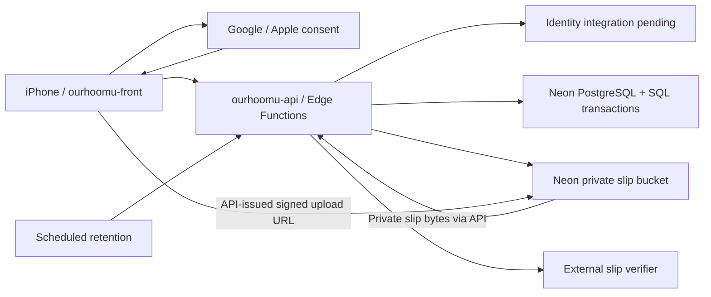

# Architecture v0.1

สถานะ: ข้อเสนอของ Tech Lead ตาม requirement ที่ยืนยันแล้ว

## Stack

| ชั้น | เทคโนโลยี | หน้าที่ |
|---|---|---|
| iOS UI | Expo, React Native, TypeScript, Expo Router | navigation, form, native sign-in UI, ถ่าย/เลือกรูป |
| Client state | TanStack Query, React Hook Form, Zod, SecureStore | server cache, validation, เก็บ session อย่างปลอดภัย |
| API | TypeScript backend; runtime/hosting รอตรึงตาม ADR-0002 | auth/session gateway, permissions, validation, slip adapter ยังไม่ deploy |
| Database | Neon PostgreSQL; SQL migrations, grants/RLS และ transactions รอ implementation | เงินและ state changes ที่ต้อง atomic |
| Files | Neon Object Storage bucket slip: private | infrastructure ตรวจแล้ว; app permissions ยังไม่พัฒนา |
| Authentication | Google/Apple ผ่าน API; ต้องตรวจ integration กับ Neon Auth ที่เปิดอยู่แล้ว | ยังไม่มี app session/native login proof |
| Background maintenance | Scheduler/retention/outbox worker รอเลือกกับ API hosting | purge แม้ไม่มีใครเปิดแอป; LINE OA ยืนยันการจ่ายตาม R16; ไม่มี APNs/Expo Push |

เพิ่ม [LINE OA payment notifications](line-oa.md): transaction ยืนยันเงินบันทึก outbox พร้อม domain event; worker ส่ง Messaging API หลัง commit ด้วย server credentials เท่านั้น LINE failure ไม่ย้อนเครดิต ปลายทางและ binding ยังรอผู้ใช้ยืนยัน ไม่ใช่ integration ที่ deploy แล้ว

แบบ PostgreSQL ล่าสุด: [database design](database.md) แสดง 29 ตารางพร้อม ERD, data dictionary, composite tenant FKs, money/chores/LINE transactions และ purge/restore; เป็น proposed contract สำหรับ SW-0004 ยังไม่มี domain tables ที่ deploy แล้ว
| Distribution | Expo development build, EAS Build, TestFlight | ทดสอบ native integrations และแจก beta |

ให้ scaffold ticket pin versions ที่เข้ากันจริงจาก official docs ตอนเริ่ม ไม่ pin SDK จากการคาดเดาในเอกสารนี้

## ขอบเขตและ trust boundaries

Database/private bucket ยืนยันตาม [ADR-0002](../adr/0002-neon.md) Frontend ไม่ถือ DATABASE_URL/storage credentials หรือ query domain tables โดยตรง Native consent และ signed upload เป็นข้อยกเว้นตาม contract; slip download ผ่าน API ที่ตรวจสิทธิ์สด SQL grants/RLS ต้องตรึง actor context และ connection role บน Neon ไม่สมมติ Supabase semantics

## Google/Apple ผ่าน API

1. แอพขอ login challenge จาก API; challenge ผูก provider/nonce อายุสั้นและใช้ครั้งเดียว
2. เปิด native Google/Apple consent บนเครื่อง ซึ่งเลี่ยงไม่ได้แม้ session ทำผ่าน backend
3. ส่ง provider ID token และ challenge proof ไป API ทาง TLS
4. Identity integration ที่เลือกต้องตรวจ token signature, issuer, audience, expiry และ nonce แล้วแลกเป็น app session ผูก challenge กับ verified token ไม่เขียน custom token cryptography โดยไม่มี contract
5. API ส่ง access/refresh token ให้ SecureStore; refresh/revoke/logout ผ่าน API เช่นกัน ทุก protected route ตรวจ session ที่เชื่อถือได้ก่อนใช้ user ID
6. ไม่เชื่อ user ID/email/role จาก body; ไม่เก็บ token ใน logs ไม่ใช้ email หรือชื่อเป็น account identity

Google/Apple ต้องพิสูจน์บน development build/iPhone จริง แยก public auth จาก protected endpoints Remote Neon Auth เปิดอยู่แล้ว แต่ยังไม่พิสูจน์ native integration/linking policy และไม่ใช้ Neon CLI login เป็น app-user login

Slip reads ผ่าน authenticated API stream ตรวจ live membership/uploader/recipient/expiry ทุก request และ no-store โดยไม่คืน direct Storage read URL Signed upload จำกัด path/expiry และตรวจสิทธิ์ซ้ำก่อน finalize การมี private bucket อย่างเดียวยังไม่ทำให้กติกา uploader/recipient สำเร็จ

## Atomicity

API validate input → เรียก RPC ที่ทำ permission check และ transaction → คืน authoritative state การเผยแพร่บิลต้องสร้าง shares และ self-covered share รวมกัน การรับงวดต้องล็อก share/bill แล้วตรวจยอดคงเหลือและ unique bank reference ภายใต้ transaction

การเรียก slip provider เป็น network I/O นอก transaction: reserve attempt → ตรวจภายนอก → finalize idempotently ถ้า timeout เก็บ unknown/pending แล้ว reconcile; ไม่ถือว่า failed แน่นอนและไม่เริ่มหักยอดใหม่ Blind retries อาจเสียโควตาและเจอ provider duplicate

SQL functions แบบ SECURITY DEFINER ถ้าจำเป็นต้องมี fixed search_path, schema-qualified names, explicit actor/membership checks และจำกัด execute grants RLS ใช้ live membership ไม่พึ่ง role ใน JWT ที่เก่า Actor context/connection role ต้องตรึงบน Neon และทดสอบว่าปลอมจาก client หรือข้าม invariants ไม่ได้ ไม่มี Supabase auth.uid() ให้สมมติว่าใช้ได้ทันที

## Scaling path

10 คน: API เดียว + managed database/storage; pagination และ indexes ตั้งแต่แรก, ไม่มี microservices/queue server เพิ่ม

เมื่อ usage/availability ต้องการ: ตรวจ Neon plan/compute/storage และ API host ที่เลือก แยก slip jobs เป็น worker/queue เมื่อจำเป็น เก็บ provider adapter เดียวเป็นค่าเริ่มต้น เปลี่ยน provider ได้โดยไม่เปลี่ยน UI contract ไม่ทำ multi-provider failover ที่เสี่ยงคิดเงินซ้ำตั้งแต่ MVP

[Domain](domain.md) · [API](api-contract.md) · [Hosting](operations.md)
