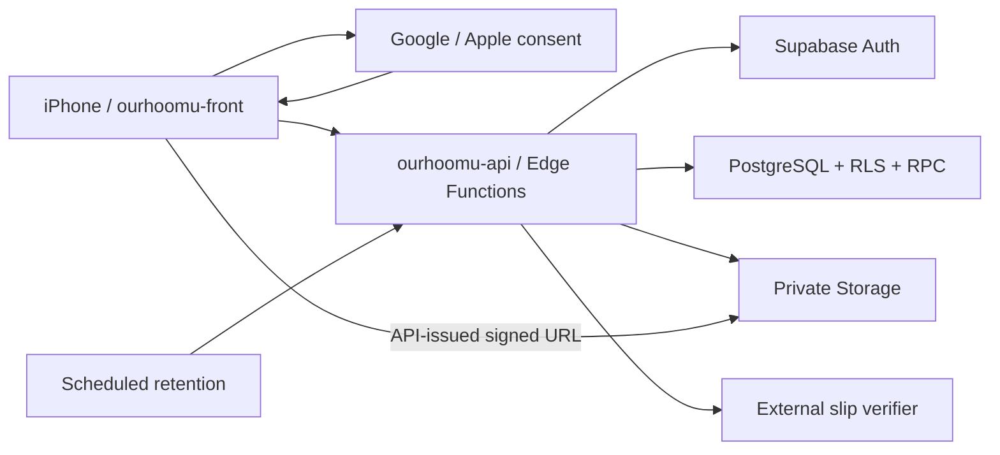

# Architecture v0.1

สถานะ: ข้อเสนอของ Tech Lead ตาม requirement ที่ยืนยันแล้ว

## Stack

| ชั้น | เทคโนโลยี | หน้าที่ |
|---|---|---|
| iOS UI | Expo, React Native, TypeScript, Expo Router | navigation, form, native sign-in UI, ถ่าย/เลือกรูป |
| Client state | TanStack Query, React Hook Form, Zod, SecureStore | server cache, validation, เก็บ session อย่างปลอดภัย |
| API | Supabase Edge Functions, Deno, TypeScript | auth/session gateway, permissions, validation, slip adapter |
| Database | Supabase PostgreSQL, SQL migrations, RLS, transactional RPC | เงินและ state changes ที่ต้อง atomic |
| Files | Supabase private Storage | สลิป; API ออก URL อายุสั้นหลังตรวจสิทธิ์ |
| Authentication | Supabase Auth + Google/Apple | identity และ session; แอพแลก/refresh/revoke ผ่าน API |
| Background maintenance | Supabase Cron + retention function | purge ประวัติ/ไฟล์ตามอายุ; ไม่ส่ง notifications |
| Distribution | Expo development build, EAS Build, TestFlight | ทดสอบ native integrations และแจก beta |

ให้ scaffold ticket pin versions ที่เข้ากันจริงจาก official docs ตอนเริ่ม ไม่ pin SDK จากการคาดเดาในเอกสารนี้

## ขอบเขตและ trust boundaries

Frontend ไม่เรียก domain tables หรือ Supabase Auth โดยตรง ยกเว้นรับส่งไฟล์ผ่าน URL ที่ได้รับอนุญาต API เป็นจุดเดียวของ business authorization และ RLS/SQL grants เป็นชั้นป้องกันเพิ่ม ไม่ใช้ service-role client เป็นค่าเริ่มต้นของทุกคำขอ

## Google/Apple ผ่าน API

1. แอพขอ login challenge จาก API; challenge ผูก provider/nonce อายุสั้นและใช้ครั้งเดียว
2. เปิด native Google/Apple consent บนเครื่อง ซึ่งเลี่ยงไม่ได้แม้ session ทำผ่าน backend
3. ส่ง provider ID token และ challenge proof ไป API ทาง TLS
4. API ใช้ provider integration ของ Supabase Auth ตรวจ token (signature, issuer, audience, expiry และ nonce ตาม flow ของ provider) และแลกเป็น app session ผูก challenge กับ token ที่ตรวจแล้ว ปิดโอกาส replay
5. API ส่ง access/refresh token ให้ SecureStore; refresh/revoke/logout ผ่าน API เช่นกัน ทุก protected route ตรวจ session ที่เชื่อถือได้ก่อนใช้ user ID
6. ไม่เชื่อ user ID/email/role จาก body; ไม่เก็บ token ใน logs ไม่ใช้ email หรือชื่อเป็น account identity

Google/Apple native integrations ต้องพิสูจน์บน development build/iPhone จริง ออกแบบ public auth endpoints แยกจาก protected endpoints อย่างชัดเจนตาม [Securing Edge Functions](https://supabase.com/docs/guides/functions/auth) ผู้ให้บริการ: [Google](https://supabase.com/docs/guides/auth/social-login/auth-google), [Apple](https://supabase.com/docs/guides/auth/social-login/auth-apple)

## Atomicity

API validate input → เรียก RPC ที่ทำ permission check และ transaction → คืน authoritative state การเผยแพร่บิลต้องสร้าง shares และ self-covered share รวมกัน การรับงวดต้องล็อก share/bill แล้วตรวจยอดคงเหลือและ unique bank reference ภายใต้ transaction

การเรียก slip provider เป็น network I/O นอก transaction: reserve attempt → ตรวจภายนอก → finalize idempotently ถ้า timeout เก็บ unknown/pending แล้ว reconcile; ไม่ถือว่า failed แน่นอนและไม่เริ่มหักยอดใหม่ Blind retries อาจเสียโควตาและเจอ provider duplicate

RPC แบบ SECURITY DEFINER ถ้าจำเป็นต้องมี fixed search_path, schema-qualified names, explicit auth.uid()/membership checks, จำกัด execute grants และปิดการเขียน table ตรงที่ข้าม invariants ได้ RLS ต้องใช้ live membership จาก DB ไม่พึ่ง role ใน JWT ที่เก่า

## Scaling path

10 คน: API เดียว + managed database/storage; pagination และ indexes ตั้งแต่แรก, ไม่มี microservices/queue server เพิ่ม

เมื่อ usage/availability ต้องการ: อัปเกรด Supabase ก่อน แยก slip jobs เป็น worker/queue ที่มี durable retry เมื่อจำเป็น เก็บ provider adapter เดียวเป็นค่าเริ่มต้น เปลี่ยน provider ได้โดยไม่เปลี่ยน UI contract ไม่ทำ multi-provider failover ที่เสี่ยงคิดเงินซ้ำตั้งแต่ MVP

[Domain](domain.md) · [API](api-contract.md) · [Hosting](operations.md)
