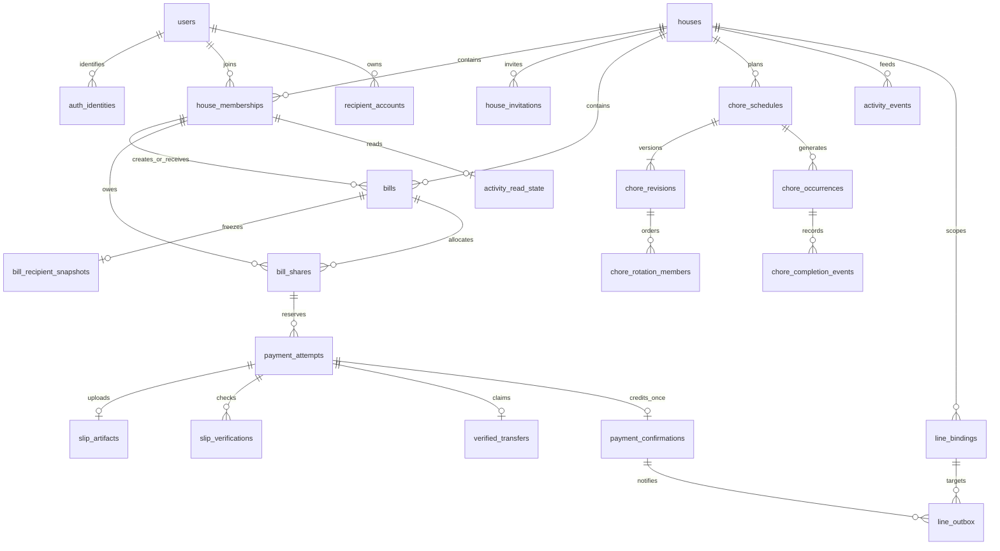
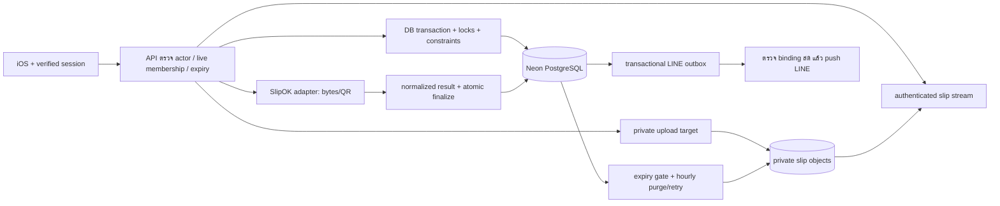

# Database design — OurHoomu (SW-0019)

วันที่ 2026-10-12 · PostgreSQL 18 / Neon · **Proposed design เท่านั้น ยังไม่มี domain schema/constraints/RLS ที่ deploy แล้ว**

แบบนี้รองรับผู้ใช้เริ่มต้นไม่เกิน 10 คนในฐานข้อมูลเดียว ใช้ relational tables, B-tree indexes และงาน background ใน API เดียว ยังไม่ต้อง partition, Redis, broker หรือบริการ queue แยก เอกสารนี้ไม่ใช่ migration และไม่อนุญาตให้รัน SQL บน production

แหล่ง requirement: [R1–R16](../team/requirements.md), [domain](domain.md), [API](api-contract.md), [decisions](decisions.md), [LINE OA](line-oa.md), [SlipOK](slip-providers.md), [ADR-0002](../adr/0002-neon.md) ข้อเสนอ D1–D12 และตัวเลข operational defaults ด้านล่างยังต้องตรวจรับก่อน implementation; SW-0004 ยังไม่เสร็จ

## 1. ขอบเขต ความสัมพันธ์ และ data flow

ใช้ app-owned `users` และ `auth_identities(issuer,subject)` ไม่ FK เข้า `auth.users` หรือเดา managed Neon Auth schema การตรวจ Google/Apple, session/refresh/revocation และ linking policy ยัง pending; identity mapping ไม่ได้เป็นหลักฐานว่า login ใช้ได้แล้ว

ERD แสดงแกนหลัก; transfer replay policy, auth challenges, idempotency, binding challenges, webhook receipts และ maintenance jobs มี dictionary ด้านล่าง ไม่ใช้เส้น ERD แทน composite FK จริง

Provider/LINE/storage network calls อยู่นอก DB transaction; transaction สั้นรับเฉพาะผล normalized ที่ backend ตรวจแล้ว In-app dashboard/feed อ่านเมื่อเปิด/foreground/refresh ไม่ต้องมี iOS push tokens

## 2. สัญลักษณ์และกติกา physical model

Dictionary ระบุทุกคอลัมน์ผ่าน common sets และแถวเฉพาะตาราง: `NN` = NOT NULL, `?` = nullable/default NULL, `=x` = default x, คอลัมน์ NN ที่ไม่ระบุ default ต้องส่งค่าโดย trusted server; `PK`, `U`, `FK`, `C`, `I` คือ primary key, unique, foreign key, row CHECK, index ตามลำดับ ไม่มี default จาก client identity

- `C0`: `created_at timestamptz NN = statement_timestamp()`; immutable หลังสร้าง ใช้ UTC และเวลา server
- `H`: รวม C0 + `expires_at timestamptz NN`, `retention_deadline_at timestamptz NN` ไม่มี default; C: `created_at < expires_at AND expires_at <= retention_deadline_at AND retention_deadline_at <= created_at + interval '8760 hours'` (365 × 24 ชั่วโมง ไม่อิง DST)
- Parent history เริ่ม access expiry ก่อน deadline 24 ชั่วโมง; child ใช้ `min(own created+365d, parent deadline)` และ `min(own deadline-24h, parent expires)`; ปฏิเสธสร้าง child หากเลย expiry แล้ว การ cap ข้ามแถวทำใน write routine/trigger ไม่ใช่ CHECK
- `J`: operational retention รวม C0 + `expires_at timestamptz NN`, `retention_deadline_at timestamptz NN`; C `expires_at<=retention_deadline_at AND created_at<retention_deadline_at AND retention_deadline_at<=created_at+8760h` ไม่บังคับ created<expires เพราะ deletion job อาจถูกสร้างหลัง access expiry; server-only worker ทำได้จน deadline, ไม่มี app read, cap parent เดิมและไม่เลื่อน deadline
- `T`: `house_id uuid NN`, `id uuid NN`; PK(house_id,id), FK house_id→houses.id; id สร้างจาก server UUID ทุกครั้ง ไม่ใช้เลขเรียงเป็นสิทธิ์
- `V`: `version bigint NN =1`, C version>0; routine เพิ่มทีละหนึ่งเมื่อ mutation ผ่าน expectedVersion
- `B`: `house_id uuid NN`, `bill_id uuid NN`; FK(house_id,bill_id)→bills(house_id,id)
- `M(x)`: FK(house_id,x)→house_memberships(house_id,id); ไม่พิสูจน์ active membership ต้องตรวจสดเพิ่มเติม
- FK shorthand ใน dictionary: memberships=house_memberships, attempts=payment_attempts, confirmations=payment_confirmations, schedules=chore_schedules, revisions=chore_revisions, occurrences=chore_occurrences, bindings=line_bindings; migration ใช้ชื่อตารางเต็มข้างซ้ายเท่านั้น
- UUID PK ไม่มี DB default ในแบบนี้; varchar/text ใช้ CHECK ความยาวตามที่ระบุ ห้าม raw tokens/secrets ใน JSON หรือ logs
- ทุก FK ใช้ ON UPDATE RESTRICT; ON DELETE RESTRICT เว้นระบุ child CASCADE ชัดเจน; UUID/tenant keys immutable ข้อมูลสมาชิกออกใช้ state ไม่ลบ FK ทิ้ง
- PK/U สร้าง index ฝั่งอ้างอิงเอง; FK ฝั่ง child ต้องมี B-tree ที่ leading columns ตรง FK หาก PK/U/I ที่ระบุยังไม่ครอบคลุม ให้เพิ่ม I(FK columns) ตอน migration ไม่สร้างซ้ำ
- H ทุกตารางมี I(expires_at,id) หรือ I(expires_at,PK columns) สำหรับ batch purge (เรียก `I_H`); ไม่ใช้ partial index predicate `now()` ไม่ใช้ CHECK ข้ามแถว/volatile clock
- `bytea` ciphertext เก็บ authenticated envelope encryption โดย backend, key อยู่นอก DB; digest ใช้ HMAC-SHA256 แบบ domain-separated ไม่ใช้ account/slip reference plaintext เป็น dedupe key
- `jsonb` ใช้เฉพาะ allowlisted metadata ขนาดจำกัด 4 KiB; CHECK เป็น object และขนาด payload, ห้ามใช้แทน FK/เงิน/recipient proof
- เพดานเงินที่เสนอ `MAX_SATANG=900000000000` (9 พันล้านบาท): integer JSON ยัง exact; เก็บ `bigint` และคูณด้วย numeric/BigInt ก่อนหาร 10000 เพดานต้องตรง API ก่อนพัฒนา

### 2.1 Identity, บ้าน, สมาชิก และบัญชี

| Table / columns (รวม common sets ที่ระบุ) | Keys, CHECK, indexes / วิธีใช้ |
|---|---|
| **users**: `id uuid NN`, `display_name text NN`, `locale text NN ='th'`, `state text NN ='active'`, C0 | PK(id); C length(display_name) 1–100, locale in(th,en), state in(active,deletion_pending); current state |
| **auth_identities**: `id uuid NN`, `user_id uuid NN`, `issuer text NN`, `subject text NN`, `provider text NN`, C0 | PK(id); U(issuer,subject); FK user_id→users; I(user_id); C provider in(google,apple), issuer/subject nonempty <=512; issuer exact allowlist จาก verifier ไม่ normalize email เพื่อ merge |
| **auth_challenges**: `id uuid NN`, `provider text NN`, `proof_digest bytea NN`, `consumed_at timestamptz ?`, `expires_at timestamptz NN`, C0 | PK(id); U(proof_digest); C provider in(google,apple), digest length32, expires>created AND expires<=created+5min, consumed NULL or created<=consumed<=expires; I(expires_at,id); ลบทันทีหลัง window ไม่เก็บ ID token |
| **houses**: `id uuid NN`, `name text NN`, `timezone text NN ='Asia/Bangkok'`, `created_by_user_id uuid NN`, `state text NN ='active'`, `archived_at timestamptz ?`, `archived_expires_at timestamptz ?`, V,C0 | PK(id); FK creator→users; C length(name)1–100, state in(active,archived), archived iff archived_at/archived_expires nonnull, created<=archived_at<archived_expires<=archived_at+8760h ถ้ามี; I(archived_expires_at,id); timezone ตรวจ IANA ที่ API; creator เป็น audit ไม่ให้สิทธิ์ owner โดยอัตโนมัติ |
| **house_memberships**: T, `user_id uuid NN`, `role text NN ='member'`, `state text NN ='active'`, `left_at timestamptz ?`, `archived_expires_at timestamptz ?`, V,C0 | U(house_id,user_id), U(house_id,id,user_id); FK user→users; C role in(owner,member), state in(active,left,removed), (state=active) iff left_at NULL, left_at>=created ถ้ามี, inactive iff archived_expires nonnull, left_at<archived_expires<=left_at+8760h; I(archived_expires_at,house_id,id); I(user_id,state,house_id), I(house_id,state,role); rejoin ใช้แถวเดิม เพิ่ม version |
| **house_invitations**: T,H, `token_digest bytea NN`, `created_by_membership_id uuid NN`, `consumed_by_user_id uuid ?`, `consumed_at timestamptz ?`, `revoked_at timestamptz ?` | U(token_digest); M(creator); FK consumer→users; C digest length32, expires<=created+168h, consumed_by/at NULL พร้อมกัน, consumed_at/revoked_at>=created ถ้ามี; routine กัน consume หลัง expiry/revoke; I(house_id,created_at,id), I_H |
| **recipient_accounts**: `id uuid NN`, `owner_user_id uuid NN`, `bank_code text NN`, `identifier_kind text NN`, `identifier_ciphertext bytea NN`, `identifier_digest bytea NN`, `key_version smallint NN`, `label text NN`, `masked_account text NN`, `is_default boolean NN =false`, `state text NN ='active'`, V,C0, `archived_at timestamptz ?`, `archived_expires_at timestamptz ?` | PK(id); U(id,owner_user_id); FK owner→users; U(owner_user_id) WHERE is_default AND state=active; I(owner_user_id,state); C state in(active,archived), kind in(bank_account,promptpay), key_version>0, digest length32, bank/label/mask bounds 32/100/64, ciphertext nonempty; archived iff archived_at/archived_expires_at nonnull, created<=archived_at<archived_expires_at<=archived_at+8760h ถ้ามี; I(archived_expires_at,id); เก็บ identifier canonical ตามชนิดก่อน encrypt |

Accounts เป็น current state ที่ผู้ใช้จัดการเอง ไม่ผูกบ้านเดียว; บิลต้องพิสูจน์ account owner คือ user ของ recipient member ในบ้านนั้น Snapshot ไม่ตามบัญชีที่แก้ภายหลัง Archived account เก็บเท่าที่จำเป็นและลบไม่เกินหนึ่งปีจากการสร้าง archive record; ไม่เก็บ revision history ของบัญชีไม่สิ้นสุด

Auth sessions/refresh secrets จะอยู่ provider หรือ app table ใดรอตรึง runtime จึงไม่เพิ่มสมมติ `neon_auth.*`/managed session columns; challenge กับ mapping ข้างต้นเป็น logical app contract หาก runtime มี challenge ที่เทียบเท่าให้เลือกแหล่งเดียวและทบทวน migration ก่อนใช้

### 2.2 บิล ผู้หาร งวด และข้อมูลตรวจสลิป

| Table / columns | Keys, CHECK, indexes / วิธีใช้ |
|---|---|
| **bills**: T,H,V, `creator_membership_id uuid NN`, `recipient_membership_id uuid NN`, `recipient_user_id uuid NN`, `title text NN`, `total_satang bigint NN`, `currency text NN ='THB'`, `status text NN ='draft'`, `due_date date ?`, `published_at timestamptz ?`, `voided_at timestamptz ?` | M(creator), FK(house_id,recipient_membership_id,recipient_user_id)→memberships(house_id,id,user_id); U(house_id,id,recipient_membership_id,recipient_user_id); C title1–200, total1..MAX, currency=THB, status in(draft,open,settled,voided); draft iff published_at NULL ยกเว้น voided draft; published/voided>=created ถ้ามี, voided iff voided_at nonnull; I(house_id,created_at DESC,id DESC), I(house_id,status,due_date), I_H |
| **bill_recipient_snapshots**: B,H, `recipient_membership_id uuid NN`, `recipient_user_id uuid NN`, `source_account_id uuid NN`, `account_version bigint NN`, `bank_code text NN`, `identifier_kind text NN`, `identifier_ciphertext bytea NN`, `identifier_digest bytea NN`, `key_version smallint NN`, `masked_account text NN`, `recipient_name text NN` | PK(house_id,bill_id); FK(house_id,bill_id,recipient_membership_id,recipient_user_id)→bills(house_id,id,recipient_membership_id,recipient_user_id) CASCADE (แทน B FK ซ้ำ); C account_version/key_version>0, digest length32, kind/bank/mask/ciphertext ตาม accounts, name1–100; I_H; source_account_id เป็น provenance UUID ไม่มี FK เพื่อให้ลบ current account ได้หลัง snapshot |
| **bill_shares**: B,H, `membership_id uuid NN`, `basis_points smallint NN`, `amount_satang bigint ?`, `self_covered boolean NN =false`, `member_name text NN` | PK(house_id,bill_id,membership_id); B FK CASCADE; M(member); C bps1..10000, amount NULL or 0..MAX, self_covered implies amount nonnull, name1–100; I(house_id,membership_id,bill_id), I_H; draft amount=NULL; หลัง publish amount อาจเป็น0จาก rounding |
| **payment_attempts**: T,B,H,V, `payer_membership_id uuid NN`, `method text NN`, `amount_satang bigint NN`, `status text NN`, `reservation_until timestamptz NN`, `reservation_released_at timestamptz ?`, `lease_until timestamptz ?`, `verification_generation integer NN =0`, `retry_count smallint NN =0`, `next_retry_at timestamptz ?`, `reason_code text ?` | U(id) สำหรับ routes ไม่มีบ้าน; U(house_id,bill_id,id,payer_membership_id); FK(house_id,bill_id,payer_membership_id)→bill_shares CASCADE; C method in(transfer,cash), amount1..MAX, generation/retry>=0, created<reservation_until<=expires, lease<=expires ถ้ามี, terminal confirmed/rejected/cancelled implies reservation_released_at nonnull; C status set ด้านล่างและ method/status compatibility; I(house_id,bill_id,payer_membership_id,status,reservation_until), I(status,next_retry_at), I_H |
| **slip_artifacts**: T,B,H, `attempt_id uuid NN`, `uploader_membership_id uuid NN`, `object_key text NN`, `sha256 bytea ?`, `size_bytes integer ?`, `media_type text ?`, `finalized_at timestamptz ?`, `upload_expires_at timestamptz NN` | U(object_key), U(house_id,attempt_id); FK(house_id,bill_id,attempt_id,uploader_membership_id)→attempts(house_id,bill_id,id,payer_membership_id) CASCADE; C key<=512, digest length32 ถ้ามี, size1..5242880, type in(image/jpeg,image/png,image/webp); finalized iff hash/size/type ครบ, created<upload_expires<=min(created+60s,expires); I_H; private table |
| **slip_verifications**: T,B,H, `attempt_id uuid NN`, `generation integer NN`, `provider text NN ='slipok'`, `provider_request_id text ?`, `outcome text NN`, `bank_namespace text ?`, `reference_digest bytea ?`, `actual_amount_satang bigint ?`, `transaction_at timestamptz ?`, `recipient_match text NN ='unknown'`, `error_class text ?`, `checked_at timestamptz NN`, `adapter_version text NN` | U(house_id,attempt_id,generation); FK(house_id,bill_id,attempt_id)→attempts(house_id,bill_id,id) CASCADE (เพิ่ม U tuple นี้บน attempts); C generation>0, provider=slipok, amount NULL or1..MAX, digest length32 ถ้ามี; match in(verified,mismatch,unknown), outcome in(valid,invalid,pending,error), error enum ตาม API; I_H; private ไม่มี raw response |
| **verified_transfers**: T,B,H, `attempt_id uuid NN`, `bank_namespace text NN`, `reference_digest bytea NN`, `transaction_at timestamptz NN`, `amount_satang bigint NN`, `claim_state text NN` | U(bank_namespace,reference_digest) **global ไม่รวม house/provider**; U(house_id,attempt_id); FK(house_id,bill_id,attempt_id)→attempts(house_id,bill_id,id) RESTRICT; C digest length32, amount1..MAX, state in(confirmed,blocked); I_H; private bank namespace ต้อง stable ตาม originating bank/rail ไม่ใช้ recipient/provider ที่เลือกหรือ provider request id |
| **payment_confirmations**: T,B,H, `attempt_id uuid NN`, `payer_membership_id uuid NN`, `amount_satang bigint NN`, `method text NN`, `confirmed_by_membership_id uuid ?`, `confirmed_at timestamptz NN` | U(house_id,attempt_id); FK(house_id,bill_id,attempt_id,payer_membership_id)→attempts(house_id,bill_id,id,payer_membership_id) CASCADE; M(confirmer ถ้ามี); C amount1..MAX, method in(cash,transfer), cash iff confirmer nonnull, confirmed_at>=created; U(house_id,bill_id,id); I(house_id,bill_id,payer_membership_id); I_H; immutable credit ledger |

`payment_attempts.status`: transfer ใช้ awaiting_upload/verifying/pending_verification/needs_attention/confirmed/rejected/cancelled; cash ใช้ awaiting_confirmation/needs_attention/confirmed/rejected/cancelled CHECK อนุญาต status ต่อ method, transition/immutability ตรวจ routine ไม่ใช่ enum อย่างเดียว เพิ่ม U(house_id,bill_id,id) บน attempts ตาม FK verification/transfer แม้ PK(house_id,id) จะบอกว่า logically unique อยู่แล้ว

ไม่เก็บ balance counter อีกชุด: confirmed sum จาก `payment_confirmations`; share self-covered ไม่สร้าง attempt/confirmation และไม่ enqueue LINE `verified_transfers` เก็บเฉพาะผลธุรกรรมจริงที่ผ่าน amount/recipient/time gates รวมผลจริงที่เครดิตไม่ได้ให้ claim_state=blocked เพื่อกันนำไปใช้บิลอื่นจน parent expiry โดย floor ป้องกัน replay หลังลบ

ไม่มี plaintext bank reference/raw provider response ใน public tables Normalized private details เก็บเท่าที่ใช้ reconcile; actual amount/time/matching ไม่เชื่อ client ค่า reference_digest สร้างจาก bank namespace + canonical bank reference ที่ไม่เปลี่ยนตาม provider ห้าม rotate HMAC key แล้วสร้าง unique key คนละค่าในช่วง reference ยัง eligible; HMAC เดิมแปลงเป็น hash ของ key ใหม่ไม่ได้โดยไม่มี canonical reference จึง pin dedicated key หรือ freeze transfers, advance floor ครอบคลุม max retained transaction timestamp ภายใต้ singleton lock แล้วเปลี่ยน key ก่อน resume พร้อม protocol ที่ทดสอบแล้ว ห้ามอ้าง rekey จาก digest อย่างเดียว

### 2.3 เวร revisions, rotation และ completion

| Table / columns | Keys, CHECK, indexes / วิธีใช้ |
|---|---|
| **chore_schedules**: T,V,C0, `creator_membership_id uuid ?`, `active_revision integer ? =1`, `state text NN ='active'`, `archived_at timestamptz ?`, `archived_expires_at timestamptz ?` | M(creator); C revision NULL or>0, state in(active,archived), active iff active_revision nonnull, archived iff archived_at/archived_expires nonnull, created<=archived_at<archived_expires<=archived_at+8760h ถ้ามี; I(archived_expires_at,house_id,id); I(house_id,state); current state; FK(house_id,id,active_revision)→chore_revisions(house_id,schedule_id,revision) DEFERRABLE INITIALLY DEFERRED |
| **chore_revisions**: `house_id uuid NN`, `schedule_id uuid NN`, `revision integer NN`, C0, `title text NN`, `mode text NN`, `timezone text NN`, `effective_from date NN`, `end_date date ?`, `frequency text NN`, `weekdays smallint[] NN ='{}'`, `fixed_membership_id uuid ?`, `rotation_anchor date ?`, `rotation_offset bigint NN =0`, `superseded_at timestamptz ?`, `archive_expires_at timestamptz ?` | PK(house_id,schedule_id,revision); FK(house_id,schedule_id)→schedules CASCADE; M(fixed ถ้ามี); C title1–200, revision>0, end>=effective, mode in(manual,repeat,rotation), freq in(once,daily,weekly), weekday values1..7 (ISO), weekly iff nonempty, offset>=0; mode=rotation iff anchor nonnull, mode=rotation implies fixed NULL; fixed NULL ใน manual/repeat หมายถึง unassigned หลังสมาชิกออก; C superseded_at/archive_expires NULL พร้อมกัน, created<=superseded_at<archive_expires<=superseded_at+8760h ถ้ามี; I(house_id,schedule_id,effective_from), I(archive_expires_at,house_id,schedule_id,revision) |
| **chore_rotation_members**: `house_id uuid NN`, `schedule_id uuid NN`, `revision integer NN`, `position integer NN`, `membership_id uuid ?` | PK(house_id,schedule_id,revision,position); U(house_id,schedule_id,revision,membership_id); FK(house_id,schedule_id,revision)→revisions CASCADE; M(member); C position>=0; contiguous nonempty pool ตรวจ publish revision routine; inherits revision lifetime ไม่มี independent history clock |
| **chore_occurrences**: T,H,V, `schedule_id uuid ?`, `schedule_revision integer ?`, `local_date date NN`, `timezone text NN`, `title text NN`, `creator_membership_id uuid ?`, `assignee_membership_id uuid ?`, `assignee_name text ?`, `status text NN ='pending'`, `completed_at timestamptz ?`, `rotation_ordinal bigint ?` | U(house_id,schedule_id,local_date) WHERE schedule_id IS NOT NULL (**ไม่ใส่ revision**); FK(house_id,schedule_id,schedule_revision)→revisions RESTRICT; C schedule_id/revision NULL พร้อมกัน, ordinal NULL or>=0, title1–200, state in(pending,completed,cancelled), completed iff completed_at nonnull และ assignee nonnull; M(creator/assignee); I(house_id,local_date,id), I(house_id,assignee_membership_id,status,local_date), I_H |
| **chore_completion_events**: T,H, `occurrence_id uuid NN`, `actor_membership_id uuid NN`, `transition_version bigint NN`, `action text NN` | FK(house_id,occurrence_id)→occurrences CASCADE; M(actor); U(house_id,occurrence_id,transition_version); C version>0, action in(completed,reopened); I(house_id,occurrence_id,created_at,id); I_H; immutable events |

Manual อาจสร้าง occurrence ตรงโดย schedule_id/revision=NULL; manual schedule ใช้ once + end_date=effective_from Repeat ใช้ fixed assignee หรือ unassigned หลังสมาชิกออก; rotation ใช้ ordered pool ชุด revision เดียว อย่าใส่ pool ใน mutable JSON

เมื่อสมาชิกออก ให้ revoke LINE bindings ที่ member หรือ verified_by อ้างสมาชิกนั้น รวม group binding ที่ต้องให้ owner ปัจจุบันผูกใหม่ ก่อน purge membership ให้ maintenance clear nullable creator/fixed/pool provenance ใน current schedules/revisions ที่ยังอ้างสมาชิก โดยรักษา pool position/ordinal และไม่เปลี่ยน completed/past snapshots; current creator NULL ให้ owner จัดการตาม role, generated occurrence creator NULL ได้ ส่วน manual creation ต้อง actor active และ creator nonnull Historical occurrence/actor refs ต้องหมดอายุ/ลบตาม deadline ก่อนลบ membership ห้ามเก็บ left-member row ถาวรเพราะ current template อ้างอยู่ การ detach เป็น privacy-maintenance exception ของ immutable revision ไม่ใช่สิทธิ์แก้เวรย้อนหลัง

Active revision/pool เป็น current state; archive schedule ต้อง clear active_revision ใน transaction เดียวกัน; เมื่อ supersede แล้วเก็บเฉพาะที่ occurrence ยังอ้างถึงและไม่เกิน min(superseded+365d, policy) ต้อง materialize snapshot/title/timezone/assignee ใน occurrence จึง purge revision หลัง occurrences หมดอายุได้ หากพบ reference ที่ยังไม่หมดอายุและชน archive deadline ให้ detach schedule provenance เป็น NULL ผ่าน maintenance routine ที่มี audit สั้นก่อนลบ revision; ไม่เลื่อน occurrence expiry

### 2.4 กิจกรรม idempotency และงานลบ

| Table / columns | Keys, CHECK, indexes / วิธีใช้ |
|---|---|
| **activity_events**: T,H, `actor_membership_id uuid ?`, `event_type text NN`, `bill_id uuid ?`, `confirmation_id uuid ?`, `occurrence_id uuid ?`, `summary jsonb NN ='{}'` | M(actor); FK(house_id,bill_id)→bills CASCADE; FK(house_id,bill_id,confirmation_id)→confirmations(house_id,bill_id,id) CASCADE; FK(house_id,occurrence_id)→occurrences CASCADE; C ไม่ผูก bill+occurrence พร้อมกัน, confirmation implies bill, type allowlist ตาม domain; U(house_id,confirmation_id,event_type) WHERE confirmation_id nonnull; I(house_id,created_at DESC,id DESC); I_H |
| **activity_read_state**: `house_id uuid NN`, `membership_id uuid NN`, `last_seen_at timestamptz ?`, `last_seen_id uuid ?`, `updated_at timestamptz NN =statement_timestamp()` | PK(house_id,membership_id); M(member) CASCADE; C cursor NULL พร้อมกัน; ไม่มี FK ไป event เพราะ event purge ได้; routine รับเฉพาะ cursor ที่ member มองเห็นจริง ไม่ยอมรับ client timestamp อนาคต และเลื่อนไปข้างหน้าเท่านั้น |
| **idempotency_records**: `id uuid NN`, `actor_user_id uuid NN`, `house_id uuid ?`, `route_scope text NN`, `key_digest bytea NN`, `request_hash bytea NN`, `state text NN ='in_progress'`, `response_code smallint ?`, `resource_kind text ?`, `resource_id uuid ?`, `response_summary jsonb ?`, H | PK(id); FK actor→users, house→houses; U(actor_user_id,route_scope,key_digest); C digest/hash length32, state in(in_progress,completed), completed iff response_code nonnull, response_code100..599; I_H; resource refs เป็น locator ไม่เป็น authority ต้อง resolve/check parent ทุก replay |
| **maintenance_jobs**: `id uuid NN`, `house_id uuid ?`, `parent_kind text NN`, `parent_id uuid NN`, `object_key text ?`, `operation text NN`, `state text NN ='queued'`, `attempts smallint NN =0`, `next_retry_at timestamptz NN =statement_timestamp()`, `lease_until timestamptz ?`, `last_error_code text ?`, J | PK(id); FK house→houses RESTRICT; U(parent_kind,parent_id,operation,object_key) NULLS NOT DISTINCT; C kind in(bill,occurrence,invitation,account,revision), operation in(delete_object,reconcile,purge), state in(queued,running,failed), attempts>=0; I(state,next_retry_at), I_H; locator ไม่มี FK parent เพื่อเก็บ deletion task ระหว่าง purge, cap จาก parent ตอนสร้าง |
| **transfer_replay_policy**: `id smallint NN =1`, `replay_floor_at timestamptz NN ='-infinity'` | PK(id), C id=1; singleton seed โดย migration, current state ไม่มีประวัติรายบุคคล; guarded routine อนุญาตเฉพาะเพิ่ม floor, RESTRICT truncate/direct update, row lock serialize transfer finalize/reference purge/key rotation; missing row ต้อง fail closed ไม่สร้างค่าเริ่มต้นใหม่ตอนรับเงิน |

Idempotency retention ของ history mutations ให้เก็บ key/hash/resource locator จน parent expiry (และไม่เกิน own365วัน) เพื่อกันสร้าง cash attempt ใหม่จาก key เก่าหลัง24h; non-history mutations เสนอ24h เป็น pending replay-window contract และต้องแจ้ง client ก่อน implementation; response เก็บ ID/status เท่านั้นไม่มีภาพ/เลขบัญชี/token คำขอ key เดิม/body ต่างคืน409 การหมดอายุ key ไม่ลบ semantic uniques (confirmation/occurrence/reference) หาก parent หมดอายุห้าม replay cached success หรือคืน resource ที่ลบแล้ว

Activity summary เป็น allowlisted ชื่อ/ยอด/สถานะที่สมาชิกอ่านได้ ไม่มี slip path, provider detail, reference หรือ bank identity; name snapshots อยู่ history ไม่ join ชื่อปัจจุบันแทนย้อนหลัง Cursor เป็น current state ที่ไม่มีสำเนา event payload

### 2.5 LINE: generic binding ที่ยังรอผู้รับ และ transactional outbox

| Table / columns | Keys, CHECK, indexes / วิธีใช้ |
|---|---|
| **line_binding_challenges**: T, `requested_by_membership_id uuid NN`, `target_kind text NN`, `challenge_digest bytea NN`, `expires_at timestamptz NN`, `consumed_at timestamptz ?`, C0 | U(challenge_digest); M(requestor); C kind in(dm,group,room), digest length32, created<expires<=created+5min, consumed NULL or created<=consumed<=expires; I(expires_at,id); authenticated one-time proof ไม่รับ destination client ตรง |
| **line_bindings**: T,V,C0, `kind text NN`, `member_id uuid ?`, `channel_key text NN`, `destination_ciphertext bytea NN`, `destination_digest bytea NN`, `key_version smallint NN`, `verified_by_membership_id uuid NN`, `state text NN ='active'`, `verified_at timestamptz NN`, `revoked_at timestamptz ?`, `expires_at timestamptz ?` | M(member ถ้ามี), M(verified_by); C kind in(dm,group,room), dm iff member nonnull, state in(active,revoked), revoked iff revoked_at/expiry nonnull, digest length32/key_version>0; U(house_id,member_id,channel_key) WHERE kind=dm AND state=active; U(house_id,channel_key) WHERE kind in(group,room) AND state=active; I(expires_at,id); active เป็น current state |
| **line_webhook_receipts**: `id uuid NN`, `channel_key text NN`, `event_id_digest bytea NN`, `event_kind text NN`, `event_at timestamptz NN`, `processed_at timestamptz ?`, H | PK(id); U(channel_key,event_id_digest); C digest length32, kind allowlist(binding/follow/unfollow/join/leave); event_at ตรวจ freshness ใน handler ไม่ใช่ clock CHECK; short expiry เสนอ24h, ไม่เก็บ raw webhook/destination; I_H; signed events ผูก parent ที่ resolve ได้แล้ว cap expiry ตามนั้น |
| **line_outbox**: T,B,H, `confirmation_id uuid NN`, `binding_id uuid NN`, `binding_version bigint NN`, `destination_digest bytea NN`, `channel_key text NN`, `retry_key uuid NN`, `template_version smallint NN`, `payload jsonb NN`, `state text NN ='queued'`, `attempts smallint NN =0`, `first_send_at timestamptz ?`, `retry_deadline_at timestamptz ?`, `next_retry_at timestamptz NN =statement_timestamp()`, `lease_until timestamptz ?`, `accepted_at timestamptz ?`, `last_error_code text ?` | FK(house_id,bill_id,confirmation_id)→confirmations(house_id,bill_id,id) CASCADE; FK(house_id,binding_id)→bindings RESTRICT; U(house_id,confirmation_id,channel_key,destination_digest), U(retry_key); C state in(queued,accepted,failed,unknown,skipped,needs_attention), attempts>=0, versions>0, digest length32; first_send/retry_deadline NULL พร้อมกัน, first_send<retry_deadline<=min(first_send+24h,expires) ถ้ามี; I(state,next_retry_at), I_H |

เมื่อ policy ยัง disabled หรือไม่มี approved active binding ให้ commit confirmation+in-app event พร้อม reason=integration_unavailable โดยไม่มี destination-specific outbox แทนการสร้างปลายทางปลอม; เมื่อมี eligible binding ให้สร้าง outbox ใน confirmation transaction เดียวกันเสมอ ไม่ backfill ย้อนหลังเมื่อเปิด LINE

ไม่มี default policy ว่าเลือก payer/recipient/ทุกคน/กลุ่ม การสร้าง binding และส่งจริงยังปิดจนผู้ใช้ยืนยัน recipient flow, message privacy, credentials และ retention สำเนา LINE Generic schema นี้รองรับ DM/group/room แต่ไม่เปิดทุกแบบโดยอัตโนมัติ Channel key เป็นชื่อ config ไม่ใช่ secret; token/secret อยู่นอก DB

ตรวจ signature จาก raw bytes ก่อน parse และ dedupe event IDs; handler ปฏิเสธ unseen webhook ที่ event_at เก่ากว่า receipt window (เสนอ24h) หรืออนาคตเกิน tolerance, ไม่ให้ replay เก่าหลัง receipt purge มาเปลี่ยน binding ใหม่ Verified webhook และ one-time challenge พิสูจน์ destination; DM ต้องผูกสมาชิกที่พิสูจน์ app identity, group/room ต้องพิสูจน์ owner และสิทธิ์ผูกกลุ่มตาม flow ที่ยัง pending Unfollow/leave/revoke เปลี่ยน binding state/version; ไม่ส่งประวัติย้อนหลังเมื่อ rebind การผูก recipient เดียวซ้ำต่าง binding ใช้ destination_digest business key กัน enqueue ซ้ำ

Outbox payload ใช้ข้อความขั้นต่ำที่ approved ไม่มี slip/บัญชี; destination ciphertext อ่านจาก binding ที่ version ตรง ก่อนส่งตรวจ state/current membership/expiry ซ้ำ ข้อมูล bindings ที่ revoke มี archive expiry ไม่เกินหนึ่งปีจาก revoke และเร็วพอ purge outbox ตาม parent; การตรวจข้ามแถวทำ routine ไม่ใช่ CHECK

## 3. Invariants และ transaction boundaries

ใช้ READ COMMITTED พร้อม explicit row locks ทุก mutation acquire idempotency record ก่อน business locks; transfer finalize, reference purge/early deletion และ reference-key rotation ต้อง lock singleton transfer_replay_policy ก่อน house เสมอ (path อื่นไม่จับ singleton นี้) จากนั้น house → memberships เรียง UUID → bill/schedule → shares เรียง UUID → attempt/occurrence → reference/confirmation/outbox ทุก write path รวม maintenance ต้องใช้ลำดับเดียวกัน สำหรับเริ่ม <=10 ผู้ใช้ serialize mutation ระดับบ้านได้โดยไม่เพิ่ม distributed locks; account update lock account เท่านั้น, publish lock account หลัง bill และ account update ห้ามย้อนมาล็อกบ้าน

DB row locks ค้างจนจบ transaction และ deadlock ยังเกิดได้ จึง retry ทั้ง transaction แบบ bounded ด้วย idempotency key เดิม อ่าน [PostgreSQL locking](https://www.postgresql.org/docs/18/explicit-locking.html) Provider call ห้ามอยู่ใน lock scope

| Invariant | DB declarative | Write routine / API responsibility |
|---|---|---|
| ไม่ชี้ parent/member บ้านอื่น | composite FK ทุก tenant relation, member-user triple | resolve actor จาก session, live active membership; ห้ามส่ง tenant authority จาก client |
| บ้าน active เหลือ owner>=1 | role/state CHECK อย่างเดียวไม่พอ | create house+owner atomic; leave/remove/role change lock house, count active owners แล้วปฏิเสธคนสุดท้าย; revoke user ต้องใช้ path เดียวกัน |
| publish sum=10000 และยอดตรง | per-share bps/amount bounds, unique member | lock bill, sum ทั้งชุดและ largest remainder; ห้าม CHECK ที่ SELECT แถวอื่น |
| recipient/account ไม่เปลี่ยนหลัง publish | snapshot FK recipient triple | routine validate owner/version/active แล้ว snapshot; revoke direct DML และ guard trigger ห้ามแก้ frozen columns |
| credit+reservation ไม่เกิน share | unique confirmation/attempt และ amount bounds | lock share, sum confirmed + reservations สด, compare; self_covered ห้าม payment |
| transfer ไม่เครดิตซ้ำทั่ว app | global U(bank_namespace,reference_digest) | verified result, same-attempt replay, replay floor/retention gates; conflict ไม่เปิดเผยบ้านอื่น |
| one occurrence / วัน | U(house,schedule,date), ไม่มี revision ใน unique | serialize generation/edit schedule; fixed/rotation preview; version conflict |
| ผู้รับเวรทำเสร็จ | unique occurrence transition version | live assignee permission, row lock, update + completion/activity atomic |
| history ไม่เกิน parent | row H CHECK local เท่านั้น | cap/min parent, immutable creation/expiry, read clock gate, purge files/copies |
| LINE ไม่เปลี่ยนเงิน | unique business event/destination | confirmation+event+outbox commit เดียว; LINE หลัง commit, bounded retries |

แผน enforcement: application role ไม่มี INSERT/UPDATE/DELETE ตรงสำหรับ aggregate tables; ให้ EXECUTE เฉพาะ typed routines ที่ทำ gates ข้างต้นและ SELECT ผ่าน constrained views/policies Migration role แยก; SECURITY DEFINER ถ้าจำเป็นต้อง schema-qualify, fixed search_path, revoke PUBLIC, validate actor และทุก transition ไม่ใช้ caller-supplied actor เป็นหลักฐาน ตัว schema ในเอกสารยังไม่ได้บังคับอะไรจริง

### 3.1 Create/join/leave และ publish

1. Invite accept resolve house จาก token digest แบบยังไม่ lock แล้ว lock house→invite และ recheck digest/house, ตรวจ token digest/expiry/revocation, ถ้าเป็น active member อยู่แล้วคืน existing membership โดยไม่ consume invite; มิฉะนั้น consume+insert/rejoin atomic unique(house,user) กัน concurrent joins
2. Leave/remove lock house+members; หาก creator หรือ recipient มี open bill ยังค้างต้องเคลียร์/void ก่อน; ห้าม owner คนสุดท้ายออก สมาชิกอื่นออกได้โดยเก็บ historical membership แต่ไม่ให้สร้าง assignments/payment ใหม่ อนาคตที่ยังไม่เริ่มของสมาชิกออกให้ unassigned พร้อม activity ห้ามเปลี่ยนผู้รับย้อนหลัง
3. Publish ตรวจ actor=creator/active, expectedVersion, bill draft/unexpired, participants active ทุกคน, recipient active และ recipient_user_id ตรง membership; recipient account row lock, owner/version/state ตรง selector แม้ client เดา ID เองก็ใช้ไม่ได้
4. ตรวจ bps รวม10000 และ participants ไม่ซ้ำ; คำนวณ floor(total×bps/10000), แจกเศษสตางค์ตาม remainder มาก→น้อย tie ด้วย membership UUID ascending; เขียน snapshot/shares/status/version/event atomic การแก้ draft/shares ต้อง lock bill เดียวกัน
5. ตรึง total/currency/participants/recipient/bank identity/name snapshots; recipient share self_covered=true ถ้า recipient ไม่อยู่ใน shares ส่วนตน=0 Creator ไม่ self-covered เว้นเป็น recipient ด้วย หากไม่มีส่วนที่ต้องจ่ายให้ settled ได้ทันที โดยไม่มี payment/LINE
6. Void lock bill/shares/attempts; มี confirmation ใดแล้วปฏิเสธ; ถ้าไม่มีให้ cancel pending/release reservation+event ไม่ลบประวัติ

Largest remainder ใช้ integer/BigInt เช่น 10001 สตางค์ × bps 3334/3333/3333 → floor 3334/3333/3333 เหลือ1 remainders=3334/3333/3333 แจกให้คนแรก → 3335/3333/3333 รวม10001; หาก remainder เท่ากันจึง tie UUID; input 3333×3 รวม9999 ปฏิเสธ ไม่เติมส่วนที่ขาดเงียบ ๆ

### 3.2 Reserve, verify และ confirm งวด

1. Create attempt ใช้ idempotency row (actor+route including house+body hash) ใน transaction เดียวกับ write; lock house/bill/share; actor ต้องเป็น share member, active, bill open, ไม่ self-covered; `available=share.amount−sum(confirmations)−sum(active reservations)` ตรวจ amount<=available
2. Reservation ที่เสนอ transfer30min/cash24h และ cap parent expiry; ไม่ถือว่า pending ลด remaining การ query reservations ใช้ reservation_released_at NULL + status pending และ reservation_until>current server time; timeout task lock share+attempt แล้ว mark released พร้อม needs_attention/cancelled ตามผลที่รู้
3. Upload ตรวจ session/uploader สด, path server-generated หนึ่ง attempt/หนึ่ง artifact, bytes/type/size จริงก่อน finalized_at; staging object เขียนครั้งเดียวและ finalize immutable เปลี่ยนรูปให้สร้าง attempt ใหม่หลัง cancel ไม่ overwrite path เดิม URL upload <=60s และ <=parent expiry; storage contract ต้องพิสูจน์ policy จริงภายหลัง
4. Claim verification generation+short lease (เสนอ2min) แล้ว commit ก่อนเรียก SlipOK; bounded retries/cooldown ผลช้า generation เก่าเขียนทับผลใหม่ไม่ได้; retries/reconcile ใช้ attempt เดิม ไม่สร้าง ledger ใหม่
5. Normalize provider status/amount/time/reference/recipient identity, ไม่ถือ HTTP200 หรือ masked name/ท้ายบัญชีเป็น verified ผลไม่เพียงพอ pending_verification/needs_attention ไม่ให้ manual approve เงินโอน
6. Finalize transfer lock replay-policy singleton→house/bill/share/attempt, ตรวจ live actor/recipient, expiry/status/generation ใหม่; verified amount=declared, recipient matching exact snapshot, transaction_at>=bill.created_at และ clock/replay floor gates ด้านล่าง
7. Insert global reference claim แล้ว recheck clock/expiry หลัง unique wait อีกครั้งก่อนเขียน ledger ใน transaction เดียวกับ unique confirmation+attempt confirmed+release reservation+activity+outbox; same attempt confirmed แล้วคืนผลเดิม; reference ของ attempt อื่นคืน conflict แบบไม่เปิดเผยข้อมูล private
8. ถ้า reservation หมดแต่ผลจริง verified: คำนวณ available ใหม่ **ไม่หัก reservation ของ attempt นี้ซ้ำ**, credit ได้เฉพาะ status ยัง reconcile ได้+ยอดพอ; ถ้ายอดไม่พอ/บิล void ให้ needs_attention ไม่เพิ่มเงิน บันทึก blocked reference เมื่อ time/amount/recipient gates ผ่านเพื่อกันสลิปไปที่อื่น; expiry แล้วไม่เครดิต/ไม่สร้าง history ใหม่
9. Cash confirm ต้อง actor=creator ของบิลและ active แม้ creator!=recipient; lock/sum/recheck เช่นเดียวกัน เปลี่ยน confirmation+event+outbox atomic; cash self-confirm เมื่อ creator เป็น payer แต่ recipient อีกคนยังเป็น decision gate ตาม decisions ไม่ยืนยันเองจากแบบนี้

`remaining=share.amount−sum(confirmations)` สำหรับคนอื่น; ต้องไม่ติดลบตาม invariant หากพบยอดผิดให้หยุด finalize/needs_attention ไม่ clamp เพื่อซ่อนเครดิตเกิน recipient self_covered remaining=0 ไม่เพิ่ม ledger fake Balance กับ settled คำนวณ/เปลี่ยนจาก transaction เดียวหลังยืนยัน; ถ้า void/expiry แล้วไม่ revive payment จากผล network ที่กลับช้า

### 3.3 Global dedupe เมื่อ reference ถูก purge — ข้อเสนอที่ต้องอนุมัติ

เงื่อนไข `transaction_at>=bill.created_at` กันใช้สลิปกับบิลใหม่ แต่ไม่พอกรณีบิล B เก่ากว่า A และยังเปิดอยู่หลัง A ถูก purge ห้ามอ้างว่า global unique ซึ่งลบแล้วกัน replay ได้ตลอดกาล และไม่เก็บ hash ของธุรกรรมตลอดไปเพื่อหลบ retention

ข้อเสนอของ Tech Lead ใช้ `transfer_replay_policy.replay_floor_at` เป็น current-state scalar ทั่วแอป ไม่มี transaction/user/bill identifiers และไม่ใช่ประวัติรายธุรกรรม ไม่เพิ่มเงื่อนไขว่าสลิปทั่วไปต้องอายุไม่เกิน24ชั่วโมง:

Floor ตรวจเฉพาะการสร้างเครดิต/claim ใหม่; same-attempt ที่ confirmed แล้วให้ตรวจ actor/live membership/expiry แล้วคืนผลเดิมก่อนประเมิน floor ไม่ลดยอดเดิมหรือเปลี่ยนผล replay เป็น failed เพราะ floor ขยับ

- Finalize ต้อง `transaction_at>=bill.created_at`, `transaction_at<=clock+clock_tolerance` (เสนอไม่เกิน2นาที รอตรวจ precision) และ `transaction_at>replay_floor_at`; ตรวจ actual server clock หลังรอ lock อีกครั้ง ไม่ใช้ transaction-start now() เป็นนาฬิกา expiry
- Finalize lock singleton ก่อน house/bill/share/attempt และถือ lock จน commit unique reference+confirmation; same-attempt confirmed replay คืนผลเดิมโดยไม่เพิ่มเครดิต ก่อน purge/early deletion ของ reference ให้ล็อก singleton เดียวกัน แล้วเพิ่ม floor เป็น `max(current_floor, max(transaction_at ของ refs ที่จะลบ))` แบบ atomic กับการลบ ไม่เลื่อน floor ถอยหลัง
- หลัง reference หาย ทุกบ้านรวมบิลเก่าปฏิเสธ auto-credit ที่ timestamp<=floor จึงไม่ต้องเก็บ reference hash หลัง parent deadline; หากหลักฐานเงินจริงเก่าไม่ผ่าน floor ให้ needs_attention ไม่เพิ่มเครดิต ไม่ให้ manual approve เงินโอน และไม่กล่าวว่าเงินไม่เคยโอน
- การลบ account/house/backup guard ก่อนกำหนดต้องผ่าน protocol floor เดียวกัน ไม่มี cascade path ลบ reference เงียบ ๆ โดยไม่เพิ่ม floor
- Restore อาจย้อน floor/ledger ให้ปิด money finalization ระหว่าง quarantine และกำหนด floor อย่างน้อยเวลาตัดกลับเข้าระบบใหม่หลังหยุด writers เดิม (restore fence) ก่อนเปิดรับเงิน; สลิปก่อน fence ต้อง reconcile ledger ที่กู้กลับมาหรือ needs_attention ไม่มีการเครดิตจากสลิปเดิมอัตโนมัติ หากกู้ยอด confirmed ไม่ได้ต้องคงการจ่ายปิดและแก้ recovery ก่อน
- Reference namespace/timestamp/precision ต้อง stable และ verified จาก SlipOK หากทำไม่ได้ยังเป็น release blocker; policy singleton อยู่ server-only, update ได้เฉพาะ guarded routine และ migration/restore role ที่ควบคุม ห้าม truncate/drop/reset floor ใน app role

นี่เป็น **proposed policy ที่ต้องตรวจรับก่อน implementation** มีผลให้สลิปเก่าบางใบที่ยังไม่เคยเครดิตอยู่ใน needs_attention หลัง purge หรือ restore ได้ ต้องยืนยัน UX/recovery สำหรับกรณีนี้ ไม่อ้างว่าฐานข้อมูลสามารถเก็บทุกประวัติไม่เกินปีและยังตรวจ replay ตลอดกาลได้โดยไม่มี tradeoff หน้าต่าง24ชั่วโมงของ LINE retry เป็นคนละเรื่อง

### 3.4 เวร revisions และ in-app feed

Schedule generation lock house+schedule; เลือก revision ตาม effective_from ของแต่ละ local_date สร้างข้างหน้า30วันด้วย unique(schedule,date) และ ON CONFLICT ไม่สร้างใหม่ `rotation_ordinal` นับจำนวน eligible scheduled dates จาก anchor ถึงวันนั้น (ไม่ใช่จำนวนครั้งที่กดเสร็จ/จำนวน request); assignee=pool[(ordinal+offset) mod pool_size]; slot NULL/สมาชิกไม่ active ให้ unassigned ไม่ skip หรือเลื่อนตำแหน่ง

แก้ schedule เพิ่ม immutable revision, active pointer+version atomic; ทบทวนเฉพาะ future pending ที่ยังไม่เริ่ม อัปเดต occurrence เดิม/assignment ตาม preview ไม่ insert revision ซ้ำวัน Completed/past คง snapshot ถ้าเอาสมาชิกออกให้ unassigned ไม่ skip คนแล้วเลื่อนเวรคนอื่นเงียบ ๆ การรับ revision ใหม่ต้องตรวจสมาชิก active และ weekdays ไม่ซ้ำ/เรียง canonical

Complete/reopen lock occurrence, require actor=assignee+active+unexpired+expectedVersion, เปลี่ยน status/completed_at+completion event+activity atomic Idempotency key เดิมคืน resource เดิม; request ใหม่ที่ already completed ไม่มี event ซ้ำ Undo ของตนเพิ่ม transition version และ event ใหม่

Feed ใช้ `(created_at,id)` keyset อ่านเฉพาะบ้านที่ยัง active member; query กรอง expiry parent+event ก่อน pagination ไม่ใช้ provider private join Dashboard แยก pending/confirmed/overdue; cursor ไม่ได้ grant permission และลบ event แล้ว cursor ยังใช้เรียงได้

ใช้ Drizzle ORM เป็น schema/query layer ตาม [SW-0020](../team/tickets/SW-0020.md) และ Drizzle Kit สร้าง SQL migrations; custom SQL สำหรับ RLS/grants/functions ยังต้อง review และทดสอบตาม invariants เดิม ORM ไม่แทน database constraints หรือ permission checks

เลือก Neon driver หลังตรวจ transaction contract บน Workers จริง: [Drizzle Neon docs](https://orm.drizzle.team/docs/connect-neon) แยก HTTP สำหรับ single/non-interactive transactions และ WebSocket สำหรับ interactive transactions; ห้ามเปลี่ยน reserve/finalize/locking เป็นหลายคำสั่งที่ไม่ atomic เพียงเพื่อใช้ HTTP driver ต้องพิสูจน์ actor context/transaction role ใน SW-0004

## 4. Authorization, RLS และ pooled runtime

users/identities/challenges เป็น own-user หรือ trusted auth-runtime scope เท่านั้น ไม่ให้สมาชิกบ้านอ่าน identity subjects; actor ต้อง users.state=active

ทุก app route ใช้ verified server actor จาก issuer/subject mapping; ห้าม trust body user_id/house_id/role เป็นสิทธิ์ API ต้องตรวจ live membership และ record expiry ทุก read/write รวม routes ที่ไม่มี houseId แล้ว resolve parent ก่อนเสมอ Direct mobile DB/storage read ไม่เปิด

| Data | Authorized read / write |
|---|---|
| House/bill/payment summary/activity | active house member; write ตาม creator/owner/assignee/payer route และ state; ไม่มี private slip fields ใน summary DTO |
| Current recipient account | owner เท่านั้น; draft creator ใช้ draft-scoped masked selector ของ recipient ที่เลือกและ active ในบ้านนั้น ไม่อ่าน directory ทั้งบ้าน |
| Published bank snapshot เต็ม | recipient หรือ bill participant ที่ต้องชำระ, active membership; creator ที่ไม่ใช่ทั้งสองเห็น masked metadata เท่านั้น |
| Slip image + verification + bank reference | uploader หรือ frozen recipient ของบิล **และ** active membership **และ** parent/child ยังไม่ expired; owner/creator ไม่มี shortcut |
| Cash confirmation | creator active เท่านั้น; เห็นจำนวนเงิน ไม่ได้สิทธิ์ภาพโอนเพิ่ม |
| LINE destination / global reference / maintenance | trusted backend job scopes เท่านั้น; API response ต้องไม่บอกข้อมูลบ้านอื่นเมื่อ unique conflict |

RLS ที่เสนอเป็น defense in depth โดย runtime role ไม่ใช่ table owner/superuser/BYPASSRLS และใช้ FORCE RLS เมื่อเหมาะสม; policies default deny, SELECT ใช้ active membership+expiry+private-viewer predicates, writes ผ่าน routines ที่ verify actor และ WITH CHECK ตาม operation ห้าม permissive policy `member OR owner` เปิด private tables แบบกว้าง รายละเอียด provider identity และ trusted actor context ต้องตรึงก่อนเขียน policy จริง ตาม [PostgreSQL RLS](https://www.postgresql.org/docs/18/ddl-rowsecurity.html) owner และ BYPASSRLS มีข้อยกเว้นจึงต้องทดสอบ role จริง

ข้อเสนอ server SQL runtime ใช้ pooled connection สำหรับ request และ direct connection สำหรับ migration/restore ไม่พึ่ง session SET/search_path/temporary tables/session advisory locks เพราะ Neon PgBouncer ใช้ transaction pooling ตาม [Neon connection pooling](https://neon.com/docs/connect/connection-pooling) (ตรวจ official source ผ่าน [Neon docs repository](https://github.com/neondatabase/website/blob/main/content/docs/connect/connection-pooling.md))

หากเลือก transaction-local actor context ให้ backend verifier ตั้งค่า transaction-local บน connection เดียวใน BEGIN เดียวกับทุก statement, schema-qualify, rollback/clear ด้วย transaction และทดสอบ pooled cross-user leakage ห้าม session variable ค้างระหว่าง request หรืออ้างว่า custom setting กันผู้ถือ DB credential ปลอม actor ได้; trusted backend เป็น boundary, client ไม่มี credential Exact driver/interactive transaction API ยัง pending; ห้ามใช้ HTTP query transport ที่ไม่คง transaction แล้วสมมติ row locks ต่อกันได้

Slip download ตรวจ session/membership/expiry สดก่อน stream ผ่าน API `private,no-store`; ไม่ redirect/read signed URL ไม่ persistent client cache; upload-only signed target ไม่ข้าม parent expiry การ remove member ที่ commit ก่อน request ใหม่ทำให้ถูกปฏิเสธ; ไม่อ้างคืน bytes ที่ส่งไปแล้วได้

## 5. Query indexes, LINE retries และ retention operations

Indexes ใน dictionary ครอบคลุม dashboard/feed/keyset, shares/confirmations aggregate และ pending worker; query ต้องมี house_id leading filters เสมอ สำหรับ global conflict lookup ให้ trusted routine คืนเพียง same-attempt หรือ conflict ไม่เปิดแถวอื่น ไม่มี partitioning/GIN JSON index ก่อนมี query จำเป็น วัด EXPLAIN (ANALYZE,BUFFERS) ด้วย synthetic data บน sandbox ใน SW-0004 ภายหลัง

LINE worker ใน API claim queued rows ด้วย short transaction + lease/SKIP LOCKED; ก่อนส่งตรวจ binding version, policy recipient, active membership และ parent expiry สด ตั้ง retry_key ครั้งเดียวก่อน first call และ persist first_send/retry_deadline **ก่อน network** เสนอ margin1นาที: retry_deadline=min(first_send+23h59m,parent expires) ใช้ key เดิมต่อ delivery ไม่สร้างใหม่เมื่อ unknown/restore

Retry เฉพาะ transient errors ตาม LINE docs ด้วย bounded attempts (เสนอ8) + backoff/jitter; accepted/duplicate retry acknowledgment ตามหลักฐานคือ accepted ไม่ใช่ delivered/read `unknown` ที่ถึง deadline→needs_attention หยุด blind retry; revoked binding/expiry→skipped, token/quota→failed/needs_attention Payment ที่ confirmed ไม่ rollback เมื่อ LINE ล่ม ไม่มีย้อนหลังเมื่อเพิ่งตั้ง credentials; self-covered/pending/rejected ไม่ enqueue ข้อมูล group/DM ที่ยังไม่ approved ใช้ disabled dispatch gate ไม่เดาปลายทาง

### 5.1 Expiry, physical purge และ restore

H parent ใช้ deadline=created+8760h, expires=deadline−24h; access ปิดเมื่อ clock>=expires ทุก API/query/RLS/file request ไม่เลื่อนอายุเมื่อ update/payment/complete/retry/restore Child deadline/expiry=min own,parent; completion/confirmation/activity/outbox/idempotency/provider/files/queue ต้องไม่ช้ากว่า parent; revision/member archive ที่มี live FK refs ให้ถือ archive expiry เป็นเป้าหมายลบด้วย ไม่ลบ current-state parents ฝ่าฝืน history refs ผู้สร้างงวดวัน364ไม่ได้อายุอีกหนึ่งปี

1. Hourly sweeper หา I_H ที่ถึง expiry, lock house+parent, ปิด access และหยุด attempts/retries/LINE, สร้าง deduplicated object-delete jobs แบบ J ภายใน original parent deadline ก่อน metadata ถูกลบ ไม่สร้าง history ที่ parent หมดอายุให้ผู้ใช้เห็น
2. ลบ staging/finalized/private objects ทุก version, derived cache และ provider copies ตาม deletion contract; retry ด้วย bounded lease+minimal locator ผู้ใช้เข้าถึงไม่ได้ระหว่าง retry แต่ยังไม่อ้าง physical purge สำเร็จจนตรวจ deletion evidence
3. หลัง object deletion สำเร็จ เพิ่ม replay floor และลบ private verifications/transfer claims/artifacts ภายใต้ singleton→house→parent lock → outbox → activity → confirmations → attempts → shares/snapshot → bill; aggregate FK CASCADE เป็น safety net ไม่ลบ DB parent ก่อนเก็บ object locator และยืนยัน file deletion
4. Occurrence purge: activity/completion events→occurrence; expired revision ที่ไม่มี live refs→rotation pool/revision; cleanup invitations/challenges/webhook receipts/idempotency และ revoked bindings เมื่อ outbox dependencies หมดก่อน; memberships/users/houses/accounts ที่ active เป็น current state ไม่ลบทุกปี
5. Jobs แบบ J ใช้ expiry ปิด app access ตาม parent แต่ worker ยังลบต่อได้จน deadline; jobs/error/log/audit/purge evidence ที่มี PII/locator ลบเมื่อสำเร็จและไม่เกิน original deadline; metrics ระยะยาวเป็น aggregate ไม่มี subject IDs/reference/hash/image ไม่มี indefinite audit table; job parent locator ไม่ใช่สิทธิ์อ่านข้อมูลเดิม
6. Alert ก่อน deadline เมื่อ object/provider deletion ยังล้มเหลว; 24h margin เป็นงบ retry ไม่ใช่หลักฐาน SLA ถ้า provider/storage/backup/branch เก็บสำเนาเกิน deadline ยังเป็น release blocker ไม่เรียกการซ่อน UI ว่า retention สำเร็จ
7. Backup/PITR/branches/provider/LINE copies ต้อง inventory และกำหนดอายุ/วิธีลบไม่เกิน original deadline; ห้าม clone production PII ไป dev Restore ใน isolated quarantine, API/jobs/LINE ปิด, purge ทุก record/file ที่ expired ตามเวลาปัจจุบันก่อนเปิด API; ไม่ reset created/expiry, ไม่ replay outbox unknown/accepted หรือ provider calls อัตโนมัติ
8. Restore อาจย้อน dedupe ledger/floor: money finalization ต้องปิดจน reconcile confirmed credits หลัง snapshot ได้ และตั้ง replay floor>=restore fence ของ cutover หลังหยุด writers เดิมก่อนเปิดใหม่ (§3.3); ห้ามลด floor หรือ reset expiry, outbox ไม่มี replayอัตโนมัติ หากกู้ confirmed ledger ไม่ได้ต้องหยุด/แจ้งผู้ใช้ ไม่เติมเครดิตจากสลิปโดยไม่ตรวจยอด

ถอนสิทธิ์ account/user หรือ housekeeping ก่อน expiry ต้องไม่ cascade ลบ global reference โดยไม่มี floor protocol ข้างต้น; การลบ references ตาม retention ทำได้พร้อม advance floor และไม่ได้เปลี่ยนยอด confirmed ของบิลที่ยัง retained

Current state archive ต้องมี archive time/expiry ที่ไม่เลื่อนด้วย update; archived house/membership/account/binding/template ที่เก็บเป็นประวัติให้ทำ deletion plan capped หนึ่งปีตั้งแต่เริ่ม archive และ parent deps ตาม H ไม่เก็บชื่อธนาคาร/token/slip เป็น tombstone ไม่สิ้นสุด รายละเอียด delete-account UX และ provider retention ยัง pending

## 6. Requirement mapping และตัวอย่าง review

| Requirement | Model / acceptance ที่แบบรองรับ |
|---|---|
| R1 iOS/TestFlight | backend UUID/UTC/THB DTO; ไม่มี iOS implementation หรือ TestFlight artifact จาก schema |
| R2 monorepo/free start | DB เดียว/API transaction+job, ไม่มี partition/queue service; Cloudflare Workers Free เลือกแล้ว; account quotas/job capacity ยังต้องตรวจ |
| R3 Google/Apple/THB | users/issuer-subject identities/challenges; currency CHECK; session runtime/linking pending |
| R4 หลายบ้าน/เชิญ | memberships unique(house,user), atomic invite+join, last-owner lock |
| R5 creator/recipient ต่างกัน | แยก member IDs; masked selector + account ownership/version snapshot |
| R6 ผู้หาร100% | bps10000 atomic publish + largest remainder + immutable shares |
| R7 หักส่วนผู้รับ | recipient share self_covered; ไม่มี fake payment/LINE; recipient อาจไม่มี share |
| R8 หลายงวด/โอน/สด | attempts reservation, normalized verification, global reference, immutable confirmations; cash creator only |
| R9 slip private | separate private tables/API stream; uploader OR recipient AND live member AND unexpired ไม่มี owner shortcut |
| R10 เวร3โหมด | schedule revisions/fixed/rotation ordered pool, unique occurrence/day, assignee completion/reopen events |
| R11 in-app updates | activity/read cursor/dashboard; ไม่มี APNs/Expo/local notification tables |
| R12 <=1ปี | H + child caps, object/jobs/provider/copies purge, quarantined restore, no perpetual dedupe hash |
| R13 scope/confirmation | design/proposals explicit; lead acceptance; ไม่ปิด implementation ticket จากเอกสาร |
| R14 SlipOK | provider adapter version/minimal normalized tables; exact recipient+retention gates ยัง pending |
| R15 Neon/private bucket | PostgreSQL18 design, API-granted roles/RLS proposed; setup bucket private ไม่ใช่ app authorization |
| R16 LINE OA | generic pending bindings+signature receipt dedupe; confirmation/outbox atomic, retry key<24h ไม่ย้อนเงิน |

| Scenario | ผลที่ต้องได้เมื่อ implementation และ sandbox tests พร้อม |
|---|---|
| 200บาท A/B50:50 Aรับ | total20000, shares10000/10000; A self-covered/remaining0, B remaining10000; ไม่มี attempt ให้ A |
| Bจ่าย40+60 | confirmed4000→remaining6000; cash6000 pending ไม่ลดหนี้แต่ reserve; creator confirm→remaining0/settled; 2 confirmations |
| Creator C, recipient A | C เลือก account A ผ่าน masked selector; publish snapshot A; A self-covered ถ้ามี share; C ไม่มีสิทธิ์ภาพ B→A และยังเป็น cash confirmer |
| Account A ถูกเปลี่ยน/ปิดก่อน publish | version/state mismatch409 ไม่มี partial snapshot; เปลี่ยนหลัง publishไม่เปลี่ยนปลายทางบิลเดิม |
| 9999/10001bps และ duplicate member | rejectทั้ง transaction; shares/status/event ไม่ถูกเขียนบางส่วน |
| Concurrent cash/transfer finalize | locks+available+unique confirmation; เครดิตไม่เกินshare แม้ request keys ต่างกัน; exact replay คืน resourceเดิม |
| Same transfer คนละบ้าน | global bank reference conflict (no private detail); เงินเพิ่มเพียงหนึ่ง attempt; provider duplicate response ต้อง reconcile attemptเดิม |
| Reservation timeout+late result | recompute available; ถ้าไม่พอ needs_attention+blocked reference ไม่สร้างเครดิต/LINE; ไม่มีการถือว่าผลธนาคารเป็น false |
| A purged แต่ B เก่ากว่ายังopen | replay floor ปฏิเสธ auto-credit transferเก่า ไม่อ้าง uniqueที่ลบแล้ว; ต้องอนุมัติ policy/UX ก่อนเปิดใช้ |
| Owner/creator ดูภาพหรือสมาชิกออก | ปฏิเสธถ้าไม่ใช่ uploader/recipientหรือไม่ active แม้เคยโหลด; feedไม่มี private detail |
| Generate/complete/reopenซ้ำ | unique(schedule,date), one transition event/version, revisionแก้อนาคตไม่เปลี่ยนpast/completed |
| Parentใกล้หมดอายุ/restore | child cap/no new replay; files+provider copiesถูกลบตามdeadline; quarantineและmoney restore gate |
| LINE timeout/rebind/24h | retry keyเดิม/ธุรกรรมไม่ซ้ำ; bindingสด; หยุดก่อน24h; ไม่มี delivered claimหรือ replayหลังrestore |

## 7. แผน migration ภายหลัง (sandbox เท่านั้นจนมี authorization ใหม่)

1. Tech Lead ตรึง design/API schema revision, pending gates และค่าขอบเขตเงิน/TTL/clock/replay floor; เลือก runtime/driver/provider/session verification/actor context ให้ชัดก่อนสร้าง grants/RLS
2. เมื่อ SW-0003/0004 ready และอนุญาต implementation สร้าง versioned migrations ภายใต้ API บน isolated **sandbox ที่ไม่มี production data** ผ่าน direct connection; สร้าง users/houses/membersก่อน aggregates แล้ว private/chores/activity/LINE, composite U/FK/check/index และ typed routines+role policies ตามลำดับ; circular schedule pointer ใช้ deferrable FK และ create schedule+revision transactionเดียว
3. ใช้ synthetic fixtures ทดสอบ constraints, all cross-house FKs, RLS ด้วย actual runtime role, private DTO/stream revoke, concurrency owner/join/publish/finalize, largest remainder, reservation expiry, dedupe floor/purge boundary/key rollover, LINE retry/binding, occurrence edit/generate และ purge/restore copies; ไม่ใช้ mockปิด SlipOK/LINE/auth integration acceptance
4. ตรวจ migration forward/rollback บน sandbox, EXPLAIN และ constraint names/API error mapping; rollback pre-release ด้วยทิ้ง sandbox ไม่ destructive rollback product money rows หากมีข้อมูลจริงภายหลังใช้ expand/contract+backup rehearsal+forward fix ตาม authorization ใหม่
5. Lead ตรวจ diff/required checks+integration, documented plan/retention evidence และผู้ใช้อนุมัติ production migration แยกต่างหาก; เอกสารนี้ไม่รันDDL/SQL, ไม่แก้neon.ts/env/packages, ไม่ส่งสลิป/LINEจริง และไม่ถือSW-0004/SW-0018เสร็จ

## 8. Primary sources และ pending gates

ตรวจเมื่อ 2026-10-12: [PostgreSQL18 constraints](https://www.postgresql.org/docs/18/ddl-constraints.html) รองรับ composite FK/unique และอธิบายข้อจำกัด CHECK ข้ามแถว; [RLS](https://www.postgresql.org/docs/18/ddl-rowsecurity.html) สำหรับ role/policy boundaries; [locking](https://www.postgresql.org/docs/18/explicit-locking.html) สำหรับ transaction row locks; [Neon pooling](https://neon.com/docs/connect/connection-pooling) / [official source](https://github.com/neondatabase/website/blob/main/content/docs/connect/connection-pooling.md) สำหรับ pooled-vs-direct; [LINE retry](https://developers.line.biz/en/docs/messaging-api/retrying-api-request/) สำหรับ retry key24h/accepted semantics

ยังต้องตัดสินใจก่อนลงมือจริง: full design approval, auth/driver/Google-Apple linking, replay floor/TTL/clock policyและlate-transfer UX, cash creator self-confirm, LINE recipient/binding/message/external copies, SlipOK sufficient multi-recipient proof/reference precision/credentials/งบ และ retention storage/provider/backups/branches OwnerคือTech Leadประสานผู้ใช้และspecialists; ความไม่พร้อมเหล่านี้ไม่ขวางการส่งแบบแต่ขวาง featureที่เกี่ยวข้อง ไม่มีข้อจำกัดใดในเอกสารนี้ถูกอ้างว่า deploy/enforce/test runtimeแล้ว
