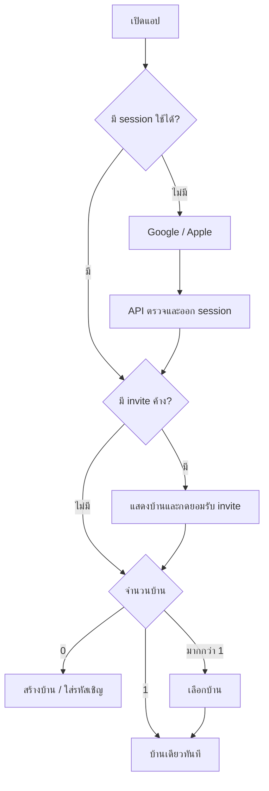

# UX และ flow v0.1

เป้าหมาย: เปิดแอปแล้วเห็นว่าต้องจ่ายอะไรและทำงานอะไร ลดการเข้าหน้าซ้อน การอนุมัติยอดสำคัญต้องเห็นผลก่อนกด ไม่ใช้สีอย่างเดียวแยกสถานะ

## เข้าสู่ระบบและเลือกบ้าน

Login มีสองปุ่มและข้อความแจ้งนโยบายข้อมูล ยกเลิก provider แล้วอยู่หน้าเดิม ไม่สร้างบ้านให้อัตโนมัติ ผู้ใช้สลับบ้านจากชื่อบ้านด้านบนได้เสมอ หากสมาชิกถูกนำออกระหว่างเปิดอยู่ให้ล้างข้อมูลแล้วกลับเลือกบ้าน

## Navigation ของบ้าน

Tab: ภาพรวม / บิล / เวร / บ้าน

ภาพรวมแสดงยอดที่ฉันยังต้องจ่าย ยอดที่รอตรวจ ยอดที่คนอื่นคืนฉัน เวรวันนี้ และกิจกรรมใหม่ เมื่อเปิด/foreground/refresh ให้ดึงใหม่พร้อมเวลาอัปเดตล่าสุด ถ้า offline แสดงข้อมูลเก่าอย่างชัดเจนและปิดการเขียนที่ต้องยืนยันจาก server

ในแอปมี badge/inbox สำหรับเงินสดรอยืนยัน สลิปต้องตรวจซ้ำ งานเลยกำหนด และเวรที่สมาชิกทำเสร็จ ไม่ร้องขอสิทธิ์ notification จาก iOS

LINE OA เพิ่มช่องทางแจ้งยืนยันการจ่ายโดยไม่ขอ iOS notification permission ของ OurHoomu; หน้าผูก/ยกเลิกและ preview ข้อความรอตรึงหลังผู้ใช้เลือกผู้รับ DM หรือกลุ่มตาม [LINE OA design](line-oa.md) การส่งล้มเหลวไม่ทำให้รายการเงิน confirmed ดูเหมือนล้มเหลว

## สร้างบิล

1. ชื่อบิล ยอด THB วันครบกำหนด ผู้รับเงิน default ตัวเอง เมื่อเปลี่ยนเป็นสมาชิก B ดึงบัญชีที่เลือกได้จาก draft selector แสดงธนาคาร/label/เลข masked เลือก default ให้ก่อน; ถ้าไม่มีบัญชีให้ B ตั้งค่าก่อนเผยแพร่ ผู้สร้างไม่แก้บัญชีแทน B
2. เลือกสมาชิกที่จะหาร เลือกหารเท่ากันหรือกรอก % แสดงผลรวมเป็นตัวเลขและยอดต่อคนทันที
3. Preview: ค่าใช้จ่ายรวม, ส่วนผู้รับเงินที่ออกเอง, ยอดที่แต่ละคนต้องคืน, บัญชีปลายทาง, วันข้อมูลถูกลบ
4. กดยืนยัน API คำนวณและ publish จริง; การกดซ้ำไม่สร้างบิลซ้ำ

ฟอร์มไม่ยอม publish หาก % ไม่ครบ 100 แสดงข้อผิดพลาดใกล้ช่องและบอกจำนวนที่ขาด/เกิน ผู้รับเงินต้องเป็นสมาชิกปัจจุบัน ผู้สร้างที่เลือกผู้รับอื่นต้องรับรองใน preview ว่าคนนั้นเป็นผู้ที่ออกเงินก่อน

## รายละเอียดบิลและทยอยจ่าย

สมาชิกเห็นตารางส่วนรับผิดชอบ/จ่ายแล้ว/ค้าง แต่ภาพสลิปแสดงเฉพาะผู้แนบกับผู้รับ คนอื่นไม่มีปุ่มภาพและ API ก็ปฏิเสธ

เปิดภาพผ่าน authenticated API โดยไม่ cache ลง disk; เมื่อออกจากบ้าน/logout/หมดอายุให้ปิดภาพและล้าง memory การเปิดดาวน์โหลดใหม่หลังเสียสิทธิ์ต้องถูกปฏิเสธ

ปุ่ม “จ่ายบางส่วน/ทั้งหมด” ให้กรอกจำนวน เลือกโอนหรือเงินสด ถ้าโอน: แสดงบัญชี → แนบรูป → ส่งตรวจ → ผลตรวจและยอดคงเหลือใหม่ pending แยกจากจ่ายสำเร็จ retry ใช้รายการเดิม ไม่บังคับโอนเงินจริงซ้ำเมื่อ provider ช้า

เงินสดแสดง “รอผู้สร้างบิลยืนยัน” ผู้สร้างเห็นจำนวน ผู้จ่าย และ confirm/reject พร้อมเหตุ ผู้รับเงินที่ไม่ใช่ creator เห็นสถานะ เครดิตเงินสดยังไม่เพิ่มก่อนยืนยัน

Timeline เก็บแต่ละงวด/ผลตรวจ/การปฏิเสธภายในอายุข้อมูล การแนบใหม่เป็น attempt ใหม่ที่เชื่อมรายการเดิม ไม่ overwrite ภาพเดิม ประวัติที่หมดอายุจะหายรวมบิลค้าง แสดงคำอธิบายตั้งแต่ preview และรายการใกล้วันหมดอายุ

## เวร

ดูแบบวันนี้/สัปดาห์ เลือกวันแล้วเห็นงานกับชื่อผู้รับ กดทำเสร็จได้เฉพาะงานตัวเอง ยืนยันจาก API แล้วจึงแสดง completed และ event ให้สมาชิกเห็น

สร้างตารางเลือกระหว่างจัดเอง, ทำซ้ำ, หมุนอัตโนมัติ สำหรับหมุนเลือกคนเรียงลำดับและวันเริ่ม แสดง preview 2 สัปดาห์ก่อนบันทึก การแก้ตารางชัดว่าใช้กับอนาคต งานที่เสร็จแล้วคงเดิม เวรที่ unassigned แสดงให้เจ้าของตารางจัดใหม่

## สมาชิกและตั้งค่า

ชื่อบ้าน รายชื่อสมาชิก สร้างลิงก์/รหัสเชิญสำหรับ owner จัดการบัญชีรับเงินของตนเอง เปลี่ยนชื่อ display ออกจากบ้าน ออกจากระบบ และขอลบบัญชีผ่าน API

คำเชิญหมดอายุใช้ซ้ำไม่ได้; สมัครสำเร็จแล้วกลับมาคำเชิญเดิม ไม่หลงไปบ้านเดิมที่มีหนึ่งบ้าน บัญชีรับเงินใหม่ไม่เปลี่ยนปลายทางบิลเก่า

## Accessibility และสถานะระบบ

รองรับ VoiceOver, Dynamic Type, contrast, ขนาดแตะเหมาะสม แสดง text/icon พร้อมสีเสมอ จำนวนเงินสองตำแหน่งและวันที่ตาม locale ไทย; form focus ไปข้อผิดพลาดแรก

ทุกหน้ามี loading/empty/error/retry; pending verification ไม่ใช้ข้อความ “จ่ายแล้ว” การยืนยันเงินและเวรไม่ optimistic จน server ยอมรับ ทดสอบ iPhone จริง/Simulator ที่ขนาดเล็กและตัวอักษรใหญ่ก่อนรับ UI ticket
