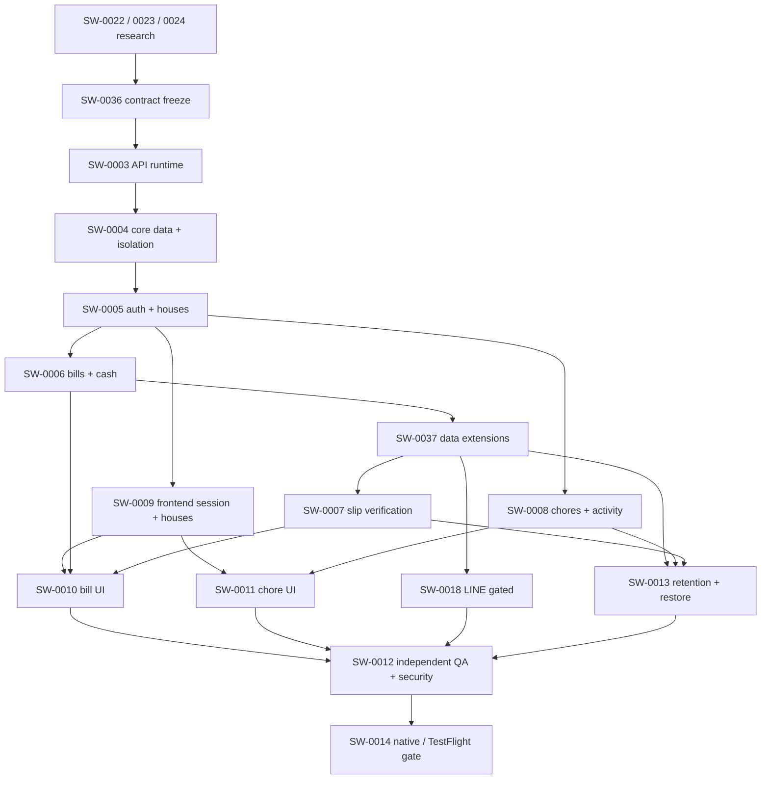

# Backend และ frontend integration — Implementation plan v0.2

2026-10-13 · SW-0033 · **เสนอให้ตรวจและยืนยันก่อน product implementation**

> Engineer workers ใช้ supervised Orca ตาม AGENTS.md; Tech Lead dispatch ตาม readiness ของแต่ละ ticket และตรวจ/รวมงานเอง. รายการด้านล่างเป็นแผน ไม่ใช่โค้ดหรือ API ที่ deploy แล้ว.

**Goal:** เปลี่ยน Expo demo ให้ใช้ backend จริงสำหรับบัญชี บ้าน บิล/ทยอยจ่าย เวร และกิจกรรม โดยคง theme/animation/calendar ที่ตรวจรับแล้ว.

**Architecture:** Elysia API เป็นทางผ่าน domain reads/writes ทั้งหมด. Drizzle/PostgreSQL บน Neon ใช้ verified actor, live membership และ atomic transactions; frontend ใช้ typed async repositories และเก็บ demo แยก. งานเก็บข้อมูล/ผู้ให้บริการภายนอกมี gate ก่อนใช้ข้อมูลจริง.

**Stack:** Bun tooling, Elysia/Cloudflare Workers Free, Drizzle/Neon PostgreSQL, React Native/Expo/Hermes. API package แยกจาก root Neon npm tooling และ Expo Bun package ที่มีอยู่.

**Spec:** [MVP spec](../project/spec.md), [requirements](requirements.md), [domain](../project/domain.md), [database](../project/database.md), [API proposed v0.1](../project/api-contract.md), [decisions](../project/decisions.md).

## 1. ขอบเขตและข้อกำหนดร่วม

- R1–R18 ที่ยืนยันแล้วเป็น source of truth; D2–D12 และ operational policies ยังเป็นข้อเสนอจนผู้ใช้ตรวจแผน.
- THB integer satang, integer bps รวม 10,000; UUID; UTC timestamps; house-local YYYY-MM-DD. Server เป็น authority ของยอด/share/status.
- pending ไม่ลดหนี้; recipient self-covered ไม่สร้าง payment; cash creator ยืนยัน; slip uploader/recipient ที่ยัง active เท่านั้นดูได้. Owner บ้านไม่มีสิทธิ์เพิ่ม.
- Mutation ออนไลน์และ idempotent; body actor/role ไม่ใช่ authority. ตรวจ fresh membership/expiry ทุก request และ transaction.
- R12 ประวัติทุกชนิดไม่เกินหนึ่งปีจากสร้าง; 365 วัน/ปิดการเข้าถึงก่อน 24h/replay floor เป็นข้อเสนอที่ต้องยืนยันแยก.
- ไม่มี APNs/Expo Push/local notification permissions. LINE เฉพาะ confirmed payments ตาม scope/ผู้รับที่จะยืนยัน.
- รักษา frontend/calendar/demo และ root Neon config. ไม่ใช้ Figma เป็น dependency.
- สร้าง isolated Git worktree ต่อ writer; schema/SQL migrations, manifests/locks, OpenAPI และ shared frontend seam มี owner เดียว. ไม่แก้ไฟล์ของ owner อื่นเอง.
- การรัน migration ใช้ฐานสังเคราะห์/Neon development branch ที่อนุญาตและยืนยัน target แล้ว; production ที่ link อยู่ไม่ใช่ dev database. External deploy/push/provider purchase/messages รอ authorization เฉพาะ.
- รายการ checks ต่อไปนี้เป็นเกณฑ์สำหรับ implementation ที่จะอนุญาตในอนาคต; รอบ planning นี้ไม่เพิ่มหรือรัน executable tests.

## 2. ข้อเสนอที่ผู้ใช้ต้องตรวจ

| Choice | ข้อเสนอของ Lead | Gate / ผลต่อผู้ใช้ |
|---|---|---|
| Design baseline | รับ D2–D6, D8–D10, D12 ตาม domain/API: UI ไทย, Bangkok default, owner/member, invite one-time 7d, ordered rotation, integer largest remainder, immutable published bill, online mutations | Core SW-0004/5/6/8 และ FE integration |
| Retention D7 | 365 วัน UTC; ปิด access/เริ่มลบเมื่อครบ 364 วัน; child ไม่เกิน parent; active current state ไม่ลบทุกปี | ผู้ใช้เห็นวันลบก่อนครบปี; physical deletion/backups/providers ต้องมีหลักฐานเพิ่มเติมก่อน release |
| Cash creator เป็น payer | อนุญาต creator ยืนยันเงินสดของตนเมื่อ recipient เป็นคนอื่น พร้อม audit และ recipient เห็นสถานะ | SW-0006 cash behavior; ยังไม่ถือว่ายืนยันแล้ว |
| Identity D11 | คง Neon Managed Auth เป็นตัวเลือกแรกสำหรับ proof; server map issuer+subject เท่านั้น ไม่ auto-link จากชื่อ/อีเมลหรือเพิ่ม account linking UI. ใช้ flow ที่ proof รองรับ Google และ Apple จริง | SW-0005/9; native exchange/refresh proof และ credentials gate. ข้อเสนอวิจัยไม่ใช่ auth integration สำเร็จ |
| Money/late verification | พิจารณาค่าจาก database design: MAX_SATANG=900000000000; ตรึง reservation TTL/clock tolerance/replay floor พร้อม error/late-transfer UX ใน SW-0036 ก่อน schema. ห้ามเดาค่าระหว่างเขียนเงิน | SW-0004/6/7. Replay floor อาจทำให้สลิปเก่า needs_attention เมื่อหลักฐานกันซ้ำถูก purge |
| LINE destination | ผู้ใช้เลือกข้อความไป recipient DM, payer+recipient DM หรือกลุ่มบ้าน และยืนยันขอบเขตสำเนา LINE | SW-0018 เท่านั้น; ไม่เดาปลายทางและไม่ส่งข้อมูลจริงก่อน binding/credentials/authorization |
| Development environment | ขอ implementation เฉพาะ local + isolated synthetic DB/dev Neon branch, โดยไม่ migrate production | SW-0003/4 และ integrated development proof; native login/slip/LINE/TestFlight มี gate ตาม evidence |

### Review focus ก่อนรับ implementation

1. Refresh reply หลัง logout/account switch ต้องไม่คืน session เก่า — SW-0005/9.
2. Account เปลี่ยน/recipient ออกจากบ้านระหว่างเลือกกับ publish ต้อง409 และไม่มี partial snapshot — SW-0004/6/10.
3. Payment response สูญหายพร้อม late verification ต้องไม่จ่าย/เครดิตซ้ำหรือเกิน share — SW-0006/7/37/10.
4. บ้านคนละ timezone/วันข้ามเที่ยงคืนและแก้ rotation ต้องคงวัน/anchor/history — SW-0008/11.
5. Purge/restore ย้อน membership/reference/outbox ต้อง fail closed ไม่คืนสิทธิ์หรือ replay เครดิต/ข้อความ — SW-0013/37/12.

## 3. Research ที่ใช้ตั้งแผน

- [SW-0022 runtime/transaction](reports/SW-0022-workers-drizzle-feasibility.md): Elysia Workers adapter เป็น experimental. เสนอ request-scoped Neon Pool/Client + Drizzle neon-serverless interactive transaction, parameterized transaction-local actor; HTTP ใช้ single/fixed batch หรือ complete SQL routine เท่านั้น. ต้องพิสูจน์ workerd/plugin/rollback/context isolation จริง.
- [SW-0024 identity](reports/SW-0024-identity-contract.md): ยังไม่มีหลักฐาน Neon Managed native Apple exchange; เสนอ bounded proof สำหรับทั้ง Google+Apple ก่อนเลือก issuer. Lead fetch OAuth Markdown จาก official source สำเร็จและพบ documented Google/GitHub/Vercel; absence ของ Apple ในหน้านี้ไม่ใช่ proof ว่า unsupported ทุกวิธี.
- [SW-0023 retention](reports/SW-0023-free-retention-feasibility.md): Free scheduler capacity ต้องวัด; backup/branch/provider copies ต้องมี deletion evidence. SlipOK FAQ มีข้อความเก็บประวัติไม่จำกัด แต่หน้ามีเนื้อหาปะปน จึงต้องยืนยัน mode-specific terms กับ provider ก่อนใช้จริง. ไม่ใช้ private bucket/access expiry แทน physical deletion proof.
- Lead source review 2026-10-13: [Elysia Workers](https://elysiajs.com/integrations/cloudflare-worker), [Neon OAuth](https://neon.com/docs/auth/guides/setup-oauth.md), [Cloudflare limits](https://developers.cloudflare.com/workers/platform/limits/), [SlipOK FAQ](https://slipok.com/faq/). ข้อสังเกต source เป็น feasibility ไม่ใช่ runtime acceptance. SW-0023 theoretical 1,200 external subrequests/day applies to one hourly Worker configuration across all jobs, not a capacity allowance per aggregate.
- [SW-0034 frontend mapping](reports/SW-0034-frontend-integration-plan.md): useDemo synchronous ต้องแยก async server repository. Missing draft/account/cash confirmation/slip/undo/session/cache states ระบุเป็นงานจริงใน SW-0009/10/11.

## 4. ลำดับงานและ wave

Scheduling capacity: Lead + ไม่เกิน 3 active workers พร้อมกัน. หลัง auth/data accepted เริ่ม backend bills, backend chores และ frontend shared session/house ได้พร้อมกันในคนละ worktree. FE bills/chores เริ่ม component/adapter slices จาก frozen contracts ได้เมื่อ prerequisite seam accepted; milestone integration รอ endpoint จริง. Mock/fixture acceptance ไม่ปิด ticket real integration.

Retention expiry predicates/child caps อยู่ SW-0004 ตั้งแต่แรก; physical purge/restore proof อยู่ SW-0013. ไม่รอท้ายโครงการจึงค่อยออกแบบ expiry. LINE สำเร็จบางส่วนจาก cash event ได้ แต่ปิด SW-0018 เมื่อ transfer/real push/all AC ที่เกี่ยวข้องครบ.

## 5. File ownership และสัญญาระหว่างทีม

| Boundary | Owner | Planned files |
|---|---|---|
| API/DTO/error/date/status revision | Tech Lead ใน SW-0036; specialists ส่งข้อเสนอ | docs/project/openapi.yaml, api-contract.md, database.md/decisions.md เฉพาะ contract change |
| Build/runtime/dependencies | platform-engineer SW-0003; changes ต่อไปผ่าน Lead | ourhoomu-api/package.json, bun.lock, tsconfig.json, wrangler.jsonc, src/index.ts, src/app.ts, README.md, scripts/; ไม่ rewrite root Neon manifests/front lock |
| Schema/atomic SQL/grants/RLS | data-engineer SW-0004 และ SW-0037 | ourhoomu-api/src/db/schema/*, src/db/operations/*, drizzle/*, src/db/runtime.ts; all DB migration files single writer |
| Auth/house/account routes | backend-engineer SW-0005 | src/modules/auth/*, users/*, houses/*, accounts/*; verified actor context types ตาม SW-0036 |
| Bill/cash routes | backend-engineer SW-0006 | src/modules/bills/*, payments/* (core cash/attempts only) |
| Chores/dashboard/activity | backend-engineer SW-0008 | src/modules/chores/*, dashboard/*, activity/* |
| Slip/provider | backend-engineer SW-0007 | src/modules/slips/*, src/integrations/slipok/*; reuse core attempt transition operations |
| LINE | backend-engineer SW-0018 | src/integrations/line/*, src/jobs/line-outbox.ts |
| Retention | backend-engineer SW-0013; platform binding via Lead | src/jobs/retention.ts, src/jobs/restore-guard.ts, docs/project/retention-runbook.md; SQL extensions via data owner |
| FE shared/session/house | frontend-engineer SW-0009 | ourhoomu-front/src/api/*, src/session/*, src/repositories/contracts.ts, server.ts, cache.ts, app/_layout.tsx, app/index.tsx, app/house/*, app/(tabs)/house.tsx; frontend package lock single owner |
| FE bill view/adapters | frontend-engineer SW-0010 | src/repositories/bills.ts, app/bill/*, app/(tabs)/bills.tsx; new account/slip/confirm surfaces assigned exact paths before dispatch |
| FE chores/feed/home | frontend-engineer SW-0011 | src/repositories/chores.ts, activity.ts, app/chore/*, app/(tabs)/chores.tsx, index.tsx, app/activity.tsx |

Paths under backend src/ are relative to ourhoomu-api. API route registration in src/app.ts is platform/Lead integration single-writer; module owners export factories and do not concurrently edit registry. src/repositories/contracts.ts and wire DTO generation are SW-0009 owner only; SW-0010/11 submit contract amendments through Lead.

### SW-0036 interface freeze deliverable

Before feature workers start, define operationId/request/response/error schema for **every route** in proposed API plus native auth lane accepted from SW-0024; list pending externally gated routes explicitly. OpenAPI valid examples cannot use demo IDs such as mew/MINT in UUID fields. Produce checked frontend wire DTOs from that revision; backend validation and fixture responses must match it. No client database schema imports.

Required shared types: ApiEnvelope<T>={data:T,requestId:string}; ApiList<T> adds nextCursor:string|null; ApiError={error:{code,message,fields?},requestId}; SessionDto; MeDto; HouseDto/MembershipDto; RecipientAccountMaskedDto; BillDraftDto/BillPublishedDto; ShareDto; PaymentAttemptSummaryDto/PrivatePaymentDto; SchedulePreviewDto/ChoreOccurrenceDto; DashboardDto/ActivityDto. Define version/expiry/canPerform projection and filter query semantics for each; never mix masked/full bank details in generic summaries.

Repository signatures agreed for FE: session bootstrap/exchange/refresh/logout/me; houses list/create/acceptInvite/detail/members/rename/account management; bills list/detail/createDraft/patchDraft/publish/payment request/cancel/cash confirm/reject/slip verify/reconcile/fetch; chores list/preview/createManual/createSchedule/complete/reopen; activity dashboard/list/markRead. Every network method returns a Promise with typed success/error, takes explicit houseId where appropriate, and never reports success from local demo state. Exact DTO fields/signatures freeze in SW-0036 rather than each worker inventing them.

## 6. Task-by-task deliverables

### SW-0036 — Freeze API/actor/operational contract (Tech Lead + specialist review)

Consumes research22/23/24, frontend34, approved material choices. Produces revisioned OpenAPI/typed DTOs, auth adapter contract, global SQL lock order/operation inputs, TTL/clock/money limits, expiry/error semantics and ownership registry. Platform and FE generated outputs have one owner.

- [ ] Define valid UUID examples, 20/100 cursor bounds, Idempotency-Key/body-hash conflict409, expectedVersion409 and minimal private DTO projection.
- [ ] Map every endpoint to DB operation and frontend repository method; freeze logout/refresh races and account deletion/membership/cash self-confirm policies.
- [ ] Review schema/examples/contracts with backend/data/FE; include cases 9999/10001bps, 20000satang A/B, account changed before publish, stale membership, expired item and late transfer.
- [ ] Lead record approved revision/decisions and dispatch gates; contract proposal does not close real integration AC.

### SW-0003 — Runnable API foundation (platform-engineer)

Consumes SW-0036 and runtime22/auth24. Produces makeApi(dependencies) and Cloudflare fetch entry using compiled Elysia adapter, config/env parser, error envelope/request IDs, reproducible API Bun package; version pinning occurs from current compatible docs. Existing front scaffold/calendar is accepted and not rebuilt. Native startup remains SW-0009/12 release evidence.

- [ ] Create src/index.ts, src/app.ts, manifests/config/scripts/README; document proposed bun install --frozen-lockfile, dev (Wrangler), typecheck, format, runtime-check commands after actually creating/running them.
- [ ] Observe /health, validation400, missing actor401, CORS and intended plugin set under Wrangler workerd. Confirm runtime has no Bun-only/fs dependencies.
- [ ] Prove one scoped transaction sets actor locally, rolls back on failure and clears actor on next request using synthetic DB. No production connection/migration.
- [ ] Independent platform/runtime review then Lead integrate/recheck. If experimental adapter fails, route evidenced alternative to user/Lead; no stack switch by worker.

### SW-0004 — Core schema, RLS and atomic operations (data-engineer)

Consumes foundation + frozen contract. Core scope: users/identity/session mapping, houses/members/invites/accounts, bills/shares/payment attempts/cash confirmations, chore schedules/revisions/occurrences, activity/read cursors/idempotency and expiry/child caps. Provider-specific reference/slip/LINE/delete jobs and replay-floor extensions are SW-0037; no promise of complete 29-table implementation from this core milestone.

- [ ] Generate/review Drizzle migrations, same-house composite FKs and grants/default-deny RLS. Runtime role is restricted, not owner/BYPASSRLS; missing actor denies.
- [ ] Implement operation boundary with parameterized actor set in same transaction as live membership/lock/write. Produce typed operations for house/invite, publish/reserve/cash confirm, schedule/generate/complete/reopen; define fixed lock order.
- [ ] Planned checks: empty-db migration/rollback, two-house denial/forged actor/removal, no actor leak on pooled requests, concurrent invite consume/owner leave, participant duplicate and bps errors, cash reserve/finalize races, duplicate occurrence, parent-expiry boundaries. Use synthetic DB and actual role.
- [ ] Data/security reviewer freeze core schema and operation contract; Lead merge. Migration changes later owned only by data specialist.

### SW-0005 — Verified session + profile/house/account API (backend-engineer)

Consumes core data/identity contract. Produces auth/challenge/exchange/refresh/logout/me/account-deletion, house/membership/invite/leave/remove and account-owner handlers. Live auth lane must be proven; local token fixtures only prove internal boundaries.

- [ ] Implement provider/session adapter according to frozen24/36; server maps verified issuer+subject to app actor; challenge/nonce/audience/expiry/replay and revocation checked.
- [ ] House creation owner atomic; invite digest/single consume/7d; 0/1/many data; last owner and outstanding creator/recipient leave guards; account CRUD owner only.
- [ ] Produce masked eligible account selection service for bills; no cross-house directory/full account exposure. Define complete account deletion/tombstone/provenance handling with retention caps.
- [ ] Planned auth/session refresh race, replay, invite concurrent consume, membership revoke and account permission checks; independent security review plus fixture vs live-provider evidence. Actual Google+Apple development-build proof required before full acceptance.

### SW-0009 — Frontend network/session/house seam (frontend-engineer)

Consumes shared DTO revision + SW-0005 endpoints; can start transport UI against fixtures after contract freeze but integrated done requires real session/house API.

- [ ] Build typed HTTPS client/errors, serialized refresh, SecureStore/native provider flow, bootstrap/protected routes and explicit demo/server providers.
- [ ] Refactor synchronous useDemo consumers via view models; implement houses/invite/rename/members/account/leave/logout surfaces. Demo reset stays demo-only; real logout clears cache, not reseeds data.
- [ ] Loading/empty/error/offline read-only states; user+house cache keys; wipe revoked/expired data and slip memory. No silent switch to another house on403. Membership refresh on foreground/pull refresh.
- [ ] Planned two-house switch, offline mutation block, 401 refresh race/logout,403/404 unavailable,409 reload,410 wipe,429 Retry-After and native Google/Apple proof. Theme/motion/calendar remain accepted design constraints.

### SW-0006 + SW-0010 slice A — Bills/shares and cash (backend + frontend separately)

Backend owns bill/attempt core modules; FE owns bill screens/adapters. Consumes SW-0004/5 and frontend9 seam. Provider slip slice B remains SW-0007 before SW-0010 full completion.

- [ ] Backend draft/create/edit/publish/void endpoints validate recipient active account/version and participant same-house; immutable publish uses largest remainder/BigInt; expose authorized summary/remaining/reserved/expiry.
- [ ] Backend reserve/cancel/cash creator confirm/reject with idempotency/body hash/version and fresh share locks; verified credit immutable/event atomic. SW-0037 later adds atomic LINE outbox; no event marked dispatched now.
- [ ] FE adds draft/account selector/no-account guidance/version-conflict states; pending/confirmed/rejected cash and creator actions with typed permission flags. Remove live hardcoded bank/demo success behavior.
- [ ] Planned exact assertions: total20000, A recipient share10000 self-covered/outstanding0, B remaining10000; confirmed4000 → remaining6000; cash6000 pending remains6000; creator confirms →0. Race/retry no double credit; creator !=recipient private DTO guard.
- [ ] Independent financial/authorization review; integrated real API+synthetic DB checks. Bills/cash can ship development milestone while transfer/LINE gates remain explicit.

### SW-0008 + SW-0011 — Chores, dashboard and activity (backend + frontend separately)

Consumes data/auth + frontend seam. Backend modules/FE chores/home/activity adapters are disjoint from bills worktrees.

- [ ] Server preview/manual/repeat/rotation with house timezone, anchor/ordered pool/revision and idempotent 30-day generation. Removal yields future unassigned without silently rotating replacements.
- [ ] Assignee complete/reopen/event atomic; creator/owner edit future only; dashboard/activity privacy/expiry/cursor read. No notification permission/jobs.
- [ ] FE keeps chore calendar, maps actual schedule preview/occurrence IDs/version/status; adds reopen/unassigned/edit/error states and foreground freshness.
- [ ] Planned daily/weekly/rotation/date boundary/revision/race checks: repeated GET no duplicates; completion order never changes rotation; removed assignee history preserved; future assignment restrictions; expiry/private feed. Integrated house timezone proof, not device-local dateOffset.

### SW-0037 — Provider/retention data extensions (data-engineer)

Consumes accepted core data/bills + provider/LINE/retention contract gates relevant to each slice. Own remaining designed tables/private slip metadata/verifications/global transfer claims, monotonic replay-policy singleton, LINE bindings/receipts/outbox/delivery and durable object-delete jobs; no handler/provider network ownership.

- [ ] Define private projections and unique reference normalized by bank rail; purge-before-reference-delete and restore floor monotonicity. No indefinite PII/digest ledger.
- [ ] Extend confirmation operation to optional frozen LINE enqueue within same transaction; never enqueue self-covered/pending/rejected, and event remains committed if sender fails.
- [ ] Add lease/SKIP LOCKED claim/retry, parent caps and SQL deletion ordering. Prefix additive migrations reviewed with data owner; handlers consume typed frozen operations.
- [ ] Planned race/late-result/global duplicate/binding revoke/retry deadline/purge/restore checks as restricted roles. Accept slices independently; whole ticket done only when all relevant gates/AC complete.

### SW-0007 + SW-0010 slice B — Private slip + verification (backend + frontend separately)

Consumes SW-0037 slip schema, bills/auth, SW-0023 and sufficient SlipOK matching/retention evidence. Credentials/branch ID/approved budget supplied outside Git before real-provider calls.

- [ ] Upload target server-scoped ≤60s/capped expiry; actual JPG/PNG/WEBP ≤5MB validated; immutable finalized object. Download authenticated binary private,no-store, no bearer read URL; fresh uploader/recipient membership/expiry on each request.
- [ ] Provider verifies bytes and exact amount/recipient/time/reference; calls outside DB money locks; atomic finalize handles confirmed/rejected/pending_verification/needs_attention and reconcile same attempt.
- [ ] FE adds image acquisition/compression/upload/progress, pending/error/retry/reconcile, memory-only viewer and permission gates; amount confirmed only from server.
- [ ] Planned malformed/oversize/SSRF/overwrite/download removal/privacy tests and normalized SlipOK fixtures; real multi-recipient proof incl masked collisions, duplicate cross-house, timeout/quota/late result and40+60 require actual provider sandbox authorization. Mock not full done.

### SW-0018 — LINE payment confirmation (backend-engineer)

Consumes schema extensions and confirmed payment events. Destination/message/binding/external copy scope and credentials are material gates; local outbox code can progress only after those contracts approved.

- [ ] Verified raw-body webhook signature/deduplication; one-time binding/revoke and fresh membership/destination authority. No arbitrary client LINE ID as send permission.
- [ ] Atomic event/outbox on cash+transfer confirmation; sender leases/bounds retries/idempotent retry key/current binding+expiry. HTTP accepted is not delivered/read; LINE failure never changes credit.
- [ ] No slips/full bank details in messages/logs; recipient/DM/group view privacy per user-approved policy. Restore never blind replay.
- [ ] Planned signature/redelivery/429/timeout/token/quota/rebind/expiry/retry-window checks + credentialed push to explicitly authorized test destination. Real-send scope remains pending.

### SW-0013 — Retention + restore (backend-engineer with platform/data handoffs)

Consumes expiry primitives from core, provider extensions and domain handlers. Platform single-writer Cron/Wrangler configuration after bounded scheduler proof; data SQL owner handles migrations/routines.

- [ ] Bounded hourly sweeper, object/provider deletion before DB metadata, durable retries/leases and backlog/deadline metrics. Fail-closed access independently of physical purge success.
- [ ] Cover slip/object versions, child records, jobs, outbox/logs/cache, archived current-state entities and provider/backup/branch copies; evidence inventory per copy/owner, no blanket compliance claim.
- [ ] Quarantine restore with API/sends disabled, purge expired data first, preserve revoked membership, reconcile credit and monotonic floor before payment reopen; no timestamps reset.
- [ ] Planned clock H−24h/H, object deletion failure/backlog/provider timeout/old reference floor and restore drill checks. Free plan documented limits are not uptime/deletion guarantee; unresolved external-copy evidence blocks release.

### SW-0012 / SW-0014 — Independent integrated acceptance and native release

- [ ] QA/code/security reviewers consume frozen integrated commit; cover AC1a,AC2–AC7,AC10 with actual API/DB/native and provider evidence, boundary/money races and lost responses. Implementation owners do not approve own auth/payment changes.
- [ ] Preserve screenshot/requests/check commands/version/SHA evidence; run integrated type/runtime/DB/contract gates selected for risk after each merge. Record fixture vs real service vs native separately.
- [ ] Platform TestFlight only after real Google+Apple on development build/iPhone, full release gates, Apple/Expo credentials and explicit external publish authorization. Web/iOS JS export is not native login proof.

## 7. Ready / review / integration / cleanup contract

1. Lead changes draft→ready only after scope/decisions/prerequisite **accepted artifact**, revision/owner/files/checks and exact Orca worktree/base are recorded. Domain draft tickets are not implicitly ready from research success.
2. Dispatch max3 independent writers with real Run/Task/Dispatch/launch/model/permission evidence; no duplicate attempt while prior state live/unverifiable. Inspect exact-worktree Graft before indexed code and report status.
3. Worker sends commit/report/actual commands/outcomes and questions through Lead. Independent reviewer examines frozen artifact; findings return owner/new attempt. Shared API/schema changes go through SW-0036 owner.
4. Lead merges local in dependency order and verifies actual integrated SHA, preserves user edits. No production operations arise from local merge permission.
5. Save artifacts before worker-release, then ack delivery. Only merged/clean/unused owned worktrees/branches removed through Orca; no force. Keep blocked/dirty work with named owner/next action.

## 8. Current status และ next action

รอบนี้ส่งมอบ planning/research เท่านั้น. Backend endpoints/schema/auth/slips/LINE/native ยังไม่ผ่าน application acceptance. Lead รวม research/FE reports และ independent plan review ลง local แล้วจะระบุ actual evidence ใน [SW-0033](tickets/SW-0033.md)/board/checklist.

Next action: ผู้ใช้ตรวจ section2 และยืนยันแผน/ขอบเขต development. จากนั้น Lead ตรึง SW-0036 และเปิด platform/data/backend/frontend ตาม wave; LINE/SlipOK/native/production gates ปลดเฉพาะหลักฐาน/สิทธิ์ที่ตรงส่วน. ไม่มีการถาม permission เครื่องมือซ้ำหรือเปิดทุก role ทุก wave.
